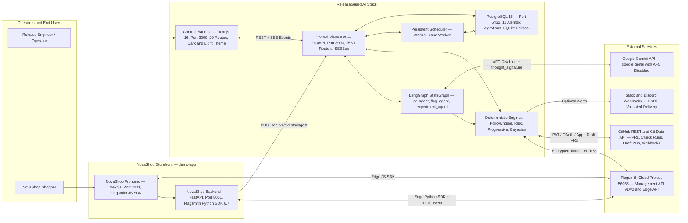
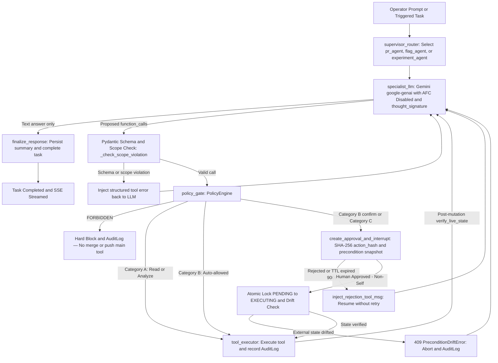
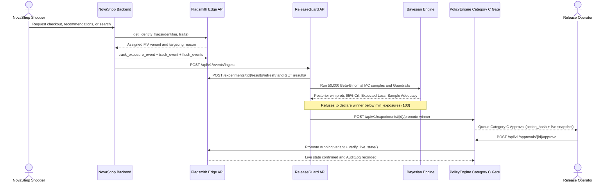
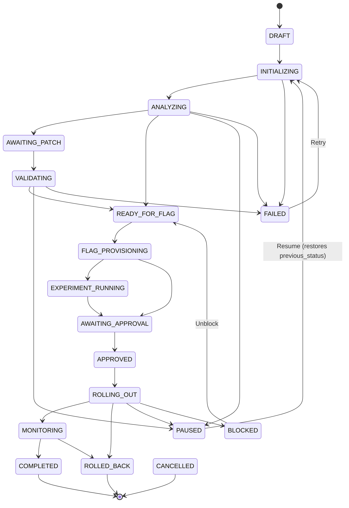
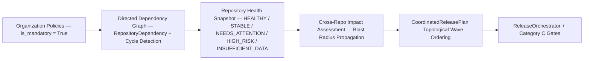
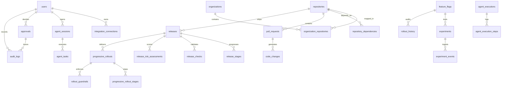

<div align="center">

# ReleaseGuard AI

**Your Autonomous AI Release Engineer — Ship Faster. Release Safer. Govern Every Flag & Experiment.**

[](https://www.python.org/)
[](https://fastapi.tiangolo.com/)
[](https://nextjs.org/)
[](https://www.postgresql.org/)
[](https://www.flagsmith.com/)
[](https://www.langchain.com/langgraph)
[](LICENSE)

Unifying **GitHub Pull Request Intelligence**, **Flagsmith Feature Flag Governance & Multivariate Experimentation**, **Pure-Python Bayesian Release Decisioning**, and **Progressive Delivery** behind an auditable **Human-in-the-Loop (HITL)** Policy Engine.

> Built for the **Flagsmith Experimentation Hackathon — Track 02 (AI Agents and Feature Flags)**.

[Architecture](#2-system-topology--runtime-architecture) · [AI & Policy Gate](#3-central-ai-orchestrator--policy-engine) · [Flagsmith Integration](#4-flagsmith-native-feature-management--experimentation) · [Phases 1–7](#5-release-engineering-platform-phases-17) · [Quick Start](#10-getting-started) · [Docs](#14-documentation-index)

</div>

---

## Table of Contents

- [1. The Problem & Core Design Invariants](#1-the-problem--core-design-invariants)
- [2. System Topology & Runtime Architecture](#2-system-topology--runtime-architecture)
- [3. Central AI Orchestrator & Policy Engine](#3-central-ai-orchestrator--policy-engine)
- [4. Flagsmith-Native Feature Management & Experimentation](#4-flagsmith-native-feature-management--experimentation)
- [5. Release Engineering Platform (Phases 1–7)](#5-release-engineering-platform-phases-17)
- [6. Relational Data Model & Migrations](#6-relational-data-model--migrations)
- [7. Control Plane UI & API Surface](#7-control-plane-ui--api-surface)
- [8. NovaShop Demo Application (`demo-app/`)](#8-novashop-demo-application-demo-app)
- [9. Monorepo Structure](#9-monorepo-structure)
- [10. Getting Started](#10-getting-started)
- [11. Environment Configuration Reference](#11-environment-configuration-reference)
- [12. Verification, Test Suites & Hackathon Walkthrough](#12-verification-test-suites--hackathon-walkthrough)
- [13. Known Limitations & Engineering Roadmap](#13-known-limitations--engineering-roadmap)
- [14. Documentation Index](#14-documentation-index)

---

## 1. The Problem & Core Design Invariants

Shipping production changes directly exposes engineering teams to silent checkout or payment regressions, manual feature-flag boilerplate, uncoordinated multi-repo dependencies, disconnected A/B analytics, orphaned flags, and stressful rollbacks.

**ReleaseGuard AI** replaces fragmented scripts and dashboards with one fail-closed control plane governed by six non-negotiable architectural invariants:

1. **Manual Function Calling Only (`AFC = Disabled`)**: Gemini proposes tool calls; it **never** executes them directly. Every call is intercepted by the LangGraph `StateGraph` supervisor, validated with Pydantic v2 schemas, checked against workspace scope, and classified by `PolicyEngine`.
2. **Untrusted Input Isolation (`XML` Sandboxing)**: Repository metadata, PR titles/bodies, diffs, commit messages, and Flagsmith descriptions are wrapped in explicit untrusted delimiters before entering LLM prompts.
3. **Deterministic Mathematics Outside the LLM**: Bayesian Beta-Binomial posteriors (`50,000` Monte Carlo draws), 95% credible intervals, expected loss, guardrail breach thresholds, DORA metrics, 7-dimension risk scores, and Flag Health scores are calculated strictly in Python (`backend/app/analytics/` and `backend/app/services/`).
4. **Never Auto-Merge & Never Silently Mutate Production**: `pr_agent` can only open **Draft PRs (`draft: true`)**; production flag toggles, rollouts, rollbacks, archives, and experiment winner promotions **always** enforce `PolicyCategory.C` single-use human approval.
5. **Pre-Execution Drift Check + Post-Mutation Readback**: Before executing any approved mutation, `approval_executor.py` verifies that live GitHub/Flagsmith state matches the captured `expected_precondition` (aborting on drift with `409`) and calls `verify_live_state()` immediately afterward.
6. **Zero-Config Local & Container Portability**: Runs on PostgreSQL 16 (`asyncpg`) via Docker Compose or standalone on SQLite (`USE_SQLITE_FALLBACK=true`) with identical Alembic migrations (`0001`–`0011`) and LangGraph checkpointing.

---

## 2. System Topology & Runtime Architecture



### Runtime Services & Ports

| Service | Host Port | Tech Stack | Primary Responsibility |
| :--- | :---: | :--- | :--- |
| **`postgres`** | `5432` | PostgreSQL 16 Alpine | Primary relational datastore, Alembic schema (`0001`–`0011`), LangGraph state checkpoints |
| **`backend`** | `8000` | Python 3.14, FastAPI, Uvicorn | REST API (`25` v1 routers), SSE stream, LangGraph supervisor, PolicyEngine, Analytics, Scheduler |
| **`frontend`** | `3000` | Next.js 16, React 19, Recharts | 29-route Governance Control Plane with `/flagsmith` Command Center & Dark/Light theme |
| **`demo-backend`** | `8001` | Python 3.14, FastAPI, `flagsmith` | Multi-variant NovaShop storefront API, Flagsmith SDK exposure/conversion tracker, telemetry emitter |
| **`demo-frontend`** | `3001` | Next.js 16, `@flagsmith/flagsmith` | Live NovaShop shopper checkout v1/v2 UI, recommendation/search variants, synthetic cohort simulator |

---

## 3. Central AI Orchestrator & Policy Engine

Every AI interaction executes inside `ReleaseGuardSupervisor` (`backend/app/agents/supervisor.py`), which enforces strict separation between **LLM reasoning** and **authorized execution**.



### Policy Categories Enforced Fail-Closed

| Policy Category | Allowed Examples | Human Gate |
| :--- | :--- | :--- |
| **`FORBIDDEN`** | `github.merge_pr`, `github.force_push`, `github.push_main`, `policy.bypass_hash`, `fs.modify_host` | Permanently rejected (403 / PolicyViolationError) |
| **`Category A`** | Repository/PR reads, static + Gemini PR analysis, `PatchValidator`, Flagsmith read/verify, Identity Explainer, Flag Health scan, Bayesian analysis | Auto-executed + audited |
| **`Category B`** | Creating disabled flags, non-production segment/rollout updates, creating Draft PRs (`draft: true`), starting non-prod test harness | Configurable confirmation (`CATEGORY_B_REQUIRES_CONFIRMATION`) |
| **`Category C`** | **Any** `production` toggle, percentage rollout, rollback, flag deletion/archive, and **`promote_experiment_winner`** / **`experiment_promote_winner`** | **Always** requires explicit single-use Human Approval with drift check |

---

## 4. Flagsmith-Native Feature Management & Experimentation

Phase 8 upgraded Flagsmith from a single toggle into the central experimentation & governance backbone via [flagsmith_client.py](backend/app/integrations/flagsmith_client.py), [flagsmith_service.py](backend/app/services/flagsmith_service.py), [flagsmith_hub.py](backend/app/api/v1/flagsmith_hub.py), and [/flagsmith](frontend/app/flagsmith/page.tsx).

### Dual-Adapter Architecture & CLI Bridge

- **v1 + v2 Feature Versioning**: Automatically inspects `use_v2_feature_versioning` per environment, creates draft feature versions (`POST .../versions/`), preserves existing `id` keys on `multivariate_feature_state_values` updates, publishes versions (`live_from`), and verifies live state via `verify_live_state()`.
- **Native Experiment Metrics & Lifecycle**: Integrates Flagsmith's `/environments/{env_key}/experiment-metrics/` (`definition: {"version": 1, "event": "<event_name>"}`) and `/environments/{env_key}/experiments/` (`/start/`, `/stop/`, `/results/refresh/`, `/results/`).
- **CLI Evaluation Bridge**: `@flagsmith/cli evaluate -e <env_key> --sdk-api-url https://edge.api.flagsmith.com --json` is verified on host against Project `#56055` (`10/10` flags), while backend Admin mutations run through `FlagsmithClient` (`FLAGSMITH_ORG_TOKEN`).

### Governed Feature Flag Catalog (`10` Provisioned Flags)

Every catalog flag is linked to executable code, automated tests, an explicit per-flag safe fallback default, and an owner SLA (never a global fallback and never used as an authorization boundary):

| Flag Key | Category | Type | Safe Default | Variants | Linked Code Paths |
| :--- | :--- | :--- | :--- | :--- | :--- |
| `checkout_v2` | NovaShop App | `STANDARD` | `enabled=False, "v1"` | `v1`, `v2` | `demo-app/backend/app/checkout.py`, `NovaShopStorefront.tsx` |
| `checkout_experience_v2` | NovaShop App | `MULTIVARIATE` | `enabled=False, "control"` | `control`, `simplified_checkout`, `one_page_checkout` | `demo-app/backend/app/checkout.py`, `CheckoutV1Form.tsx`, `CheckoutV2Express.tsx` |
| `recommendation_engine_v2` | NovaShop App | `MULTIVARIATE` | `enabled=False, "control"` | `control`, `collaborative_v2`, `personalized_v2` | `demo-app/backend/app/features.py`, `NovaShopStorefront.tsx` |
| `smart_product_search` | NovaShop App | `MULTIVARIATE` | `enabled=False, "control"` | `control`, `ranked_v2`, `semantic_v2` | `demo-app/backend/app/features.py`, `NovaShopStorefront.tsx` |
| `new_payment_flow` | NovaShop App | `MULTIVARIATE` | `enabled=False, "control"` | `control`, `express_token_v2` | `demo-app/backend/app/checkout.py`, `features.py` |
| `enable_ai_recommendations` | Kill Switch | `STANDARD` | `enabled=True` | `true` / `false` | Forces deterministic popularity sort when off |
| `enable_payment_v2` | Kill Switch | `STANDARD` | `enabled=True` | `true` / `false` | Forces classic card authorization gateway when off |
| `enable_new_search_backend` | Kill Switch | `STANDARD` | `enabled=True` | `true` / `false` | Forces simple substring search when off |
| `enable_ai_pr_review` | Capability | `STANDARD` | `enabled=True` | `true` / `false` | Gates optional Gemini PR enrichment |
| `enable_progressive_delivery` | Capability | `STANDARD` | `enabled=True` | `true` / `false` | Gates automated rollout orchestration |

### Trait Targeting Segments & Identity Variation Explainer

- **Provisioned Segments (`Project #56055`)**:
  - `rg_internal_testers` (`is_internal_tester == "true"` OR `user_type == "internal"`)
  - `rg_qa_and_beta` (`user_type == "qa"` OR `subscription_plan == "beta"`)
  - `rg_returning_enterprise` (`subscription_plan == "enterprise"`)
- **Identity Debugger (`POST /api/v1/flagsmith/identities/explain`)**: Evaluates an identity twice against Flagsmith Edge `POST /identities/` with traits (`user_type`, `subscription_plan`, `app_version`, `is_internal_tester`, `organization_id`), reporting per-flag `variant`, `enabled`, exact match `reason` (`DEFAULT`, `SPLIT`, `TARGETING_MATCH`), and `consistent_on_repeat_evaluation` (`10/10` verified).

### Live Multivariate Experiments & Bayesian Promotion Loop

Four Flagsmith native experiments are active in `Development` (`#120019`):

- **Exp `#503`**: `checkout_experience_v2` (primary: `checkout_completed`, `metric_id: 484`; guardrails: `payment_failed`, `checkout_abandoned`)
- **Exp `#504`**: `recommendation_engine_v2` (primary: `product_clicked_from_recommendation`; guardrail: `payment_failed`)
- **Exp `#505`**: `smart_product_search` (primary: `search_result_clicked`; guardrail: `checkout_abandoned`)
- **Exp `#506`**: `new_payment_flow` (primary: `payment_completed`; guardrail: `payment_failed`)



### Measured Developer Time Savings (`task-3766`)

Measured end-to-end live timings against Flagsmith Cloud Project `#56055` compared with estimated manual engineering baselines (full breakdown in [developer-time-savings.md](docs/flagsmith/developer-time-savings.md)):

| Automated Release Engineering Workflow | Automated (Measured) | Manual Baseline (Est.) | Time Saved |
| :--- | :---: | :---: | :---: |
| Provision `10` governed flags + MV splits + `3` targeting segments + `5` dev switches | `40.84 s` | ~25–35 min | ~98% |
| Create & start `4` multivariate Flagsmith experiments + `experiment-metrics/` | `40.82 s` | ~20–30 min | ~98% |
| Run Edge cohort + Flagsmith results refresh + `50,000`-sample Bayesian check | `6.68 s` | ~15–20 min | ~99% |
| **Total End-to-End Multi-Experiment Pipeline** | **`89.63 s` (~1.5 min)** | **~60–85 min** | **~97%** |

---

## 5. Release Engineering Platform (Phases 1–7)

### Core Control Plane, Auth, Scheduling & Notifications
- **Auth & RBAC (`/api/v1/auth`)**: Operator login/logout (`token_version` invalidation), GitHub OAuth, 4-role RBAC enforcement.
- **Persistent Scheduler (`/schedules`, `0003`)**: Cron & interval background jobs (`pr_sync_and_analyze`, `flag_health_scan`, `experiment_analyze`, `release_monitor`, `ai_maintenance_report`) with atomic worker leases and misfire recovery.
- **Notification Center (`/notifications`, `0004`)**: Persistent alert feed, category/severity filters, preference controls, and real-time bell counts.
- **Analytics & System Health (`/dashboard`, `/metrics`, `/system-health`, `/audit-logs`)**: Recharts Charts A–F driven by live SQL queries, DB latency readiness (`/health/ready`), liveness (`/health/live`), and CSV/JSON audit export.

### Phase 1 — Autonomous Release Lifecycle Engine (`/releases`, `0005`)

Unifies `Repository`, `PullRequest`, `CodeChange`, `FeatureFlag`, `Experiment`, `Approval`, and `AuditLog` under an optimistic-locked (`version`) 18-state FSM (`release_state_machine.py`) and 9 ordered `ReleaseStage` steps (`draft` -> `pr_analysis` -> `patch_validation` -> `flag_setup` -> `experiment_monitoring` -> `approval_gate` -> `rollout_execution` -> `post_release_verification` -> `completed`):



### Phase 2 — Agent Command Center (`/command-center`, `0006`)
- Full observability tree (`agent_executions -> agent_execution_steps -> agent_tool_calls -> agent_decisions`), execution durations, SSE streaming replay, and automatic recovery of interrupted runs on restart.

### Phase 3 — Intelligent Release Risk Engine (`/risk-intelligence`, `0007`)
- Multi-dimensional risk scorer across **7 weighted dimensions**: `code_impact` (`20%`), `dependency_impact` (`15%`), `historical_failures` (`15%`), `test_coverage` (`15%`), `production_environment` (`15%`), `feature_flag_suitability` (`10%`), and `operational_readiness` (`10%`).
- Re-normalizes across available dimensions when history is sparse (`INSUFFICIENT_DATA`), enforces critical severity overrides (e.g., destructive migrations), generates `FailureScenario` & `RiskMitigation` plans, and requires `/reanalyze` with updated evidence to change risk scores.

### Phase 4 — Progressive Delivery Engine (`/progressive-delivery`, `0008`)
- Stage-by-stage traffic progression (`1% -> 5% -> 10% -> 25% -> 50% -> 100%`) requiring minimum observation time, sample count, metric freshness, guardrail compliance, and policy approval before advancement.
- Consecutive breach detection pauses rollouts automatically and stages a `RollbackOperation` requiring production human approval + Flagsmith `verify_live_state()` confirmation.

### Phase 5 — Release Intelligence & Learning Engine (`/intelligence`, `0009`)
- Normalizes outcomes into `ReleaseOutcome` with explicit evidence quality (`VERIFIED`, `OBSERVED`, `HUMAN_REPORTED`, `AI_INFERRED`, `SIMULATED`, `UNKNOWN`).
- Tracks longitudinal DORA & rollout KPIs (`deployment_frequency`, `change_failure_rate`, `MTTR`, `lead_time_for_changes`, `rollback_rate`, `approval_latency`), recurring failure patterns, post-release verification of past AI recommendations (`RecommendationOutcome`), and human-governed policy proposals.

### Phase 6 — Developer Experience Integration (`/integrations`, `/shared/[token]`, `0010`)
- Raw-body `X-Hub-Signature-256` HMAC-verified GitHub webhook receiver (`POST /api/v1/webhooks/github`) with `delivery_id` idempotency.
- Commit-SHA-scoped GitHub Check Runs (with `is_superseded` stale protection), single-marker PR analysis comments (`<!-- releaseguard-ai:pr-comment -->`), Slack/Discord notifications (`NotificationDelivery`), and SHA-256 token-hashed revocable shareable readiness reports (`/shared/[token]`).

### Phase 7 — Multi-Repository & Organization Intelligence (`/organization`, `0011`)
- Hierarchical governance across `Organization -> OrganizationRepository -> Repository -> Release`:



---

## 6. Relational Data Model & Migrations

Schema portability across PostgreSQL 16 and SQLite 3 is handled via `Uuid(as_uuid=True)`, `JSONBCompat`, non-native `StrEnum` columns, UTC `DateTime(timezone=True)`, and Alembic batch mode (`render_as_batch=True` on SQLite).



### Alembic Migration Chain (`backend/alembic/versions/`)

| Revision | Purpose |
| :--- | :--- |
| `0001_initial_schema` | Users, IntegrationConnections, Repositories, PRs, AgentSessions/Tasks, Checkpoints, CodeChanges, Flags, RolloutHistory, Experiments/Events, Approvals, AuditLogs, WorkspaceSettings |
| `0002_auth_rbac_fields` | Operator password hashes, GitHub OAuth login binding, session revocation `token_version` |
| `0003_scheduling` | `scheduled_jobs` and `job_executions` tables |
| `0004_notifications` | `notifications` and alert delivery preferences |
| `0005_release_lifecycle` | `releases`, `release_stages`, `release_events`, `release_artifacts`, `release_checks` + approval links |
| `0006_agent_command_center` | `agent_executions`, `agent_execution_steps`, `agent_tool_calls`, `agent_decisions` |
| `0007_intelligent_release_risk` | `release_risk_assessments`, `risk_dimension_results`, `risk_findings`, `risk_evidence`, `risk_mitigations`, `risk_scenarios`, `risk_engine_configs` |
| `0008_progressive_delivery` | `progressive_rollouts`, `progressive_rollout_stages`, `rollout_metric_snapshots`, `rollout_guardrails`, `guardrail_evaluations`, `rollout_decisions`, `progressive_rollout_events`, `rollback_operations` |
| `0009_release_intelligence` | `release_outcomes`, `repository_intelligence_profiles`, `release_failure_patterns`, `release_insights`, `policy_recommendations`, `intelligence_analysis_runs` |
| `0010_dx_integration` | `github_installations`, `github_webhook_events`, `github_check_runs`, `pull_request_analysis_comments`, `notification_deliveries`, `release_readiness_reports`, `shareable_reports`, `share_link_access_logs` |
| `0011_multi_repo_intelligence` | `organizations`, `organization_repositories`, `repository_dependencies`, `cross_repo_impact_assessments`, `coordinated_release_plans`, `repository_health_snapshots`, `organization_release_policies` |

---

## 7. Control Plane UI & API Surface

### Frontend Routes (`29` Next.js App Router Pages)

| Navigation Group | Routes |
| :--- | :--- |
| **Overview** | `/` (redirects to `/dashboard`), `/dashboard`, `/metrics`, `/intelligence`, `/intelligence/repositories/[repositoryId]`, `/organization`, `/notifications` |
| **Release Operations** | `/command-center`, `/command-center/[executionId]`, `/risk-intelligence`, `/risk-intelligence/[assessmentId]`, `/progressive-delivery`, `/progressive-delivery/[rolloutId]`, `/agent`, `/repositories`, `/pull-requests`, `/flagsmith`, `/feature-flags`, `/releases`, `/releases/[id]`, `/experiments`, `/flag-health` |
| **Governance & Automation** | `/approvals`, `/schedules`, `/integrations`, `/audit-logs` |
| **Platform & System** | `/system-health`, `/settings`, `/shared/[token]` (public token-scoped readiness report viewer) |

### Backend API Routers (`/api/v1/*` + System Probes)

Mounted via [backend/app/api/v1/__init__.py](backend/app/api/v1/__init__.py):
`auth`, `dashboard`, `metrics`, `settings`, `integrations`, `repositories`, `pull-requests`, `code-changes`, `agent`, `agent-executions`, `feature-flags`, `flag-health`, `flagsmith` (`/command-center`, `/catalog`, `/catalog/provision`, `/identities/explain`, `/targeting/apply`, `/experiments/{exp_id}/run-test-harness`), `releases`, `rollouts`, `intelligence`, `dx` (GitHub App/Webhooks/Check Runs, Slack/Discord, Shareable Reports), `organization`, `risk-assessments` + `risk-engine`, `experiments` (`/plan`, `/activate`, `/stop`, `/analysis`, `/recommendation`, `/refresh-flagsmith-results`, `/promote-winner`), `events` (`/ingest`, `/stream`), `approvals`, `audit`, `schedules`, `notifications`, `system`, plus root probes `/health`, `/health/live`, and `/health/ready`.

---

## 8. NovaShop Demo Application (`demo-app/`)

NovaShop provides a live e-commerce target wired to Flagsmith Python SDK (`flagsmith==6.7.0`) and `@flagsmith/flagsmith` JS SDK rather than simulated UI state:

- **`GET /api/flags`**: Evaluates all catalog features & targeting traits (`user_type`, `subscription_plan`, `app_version`, `is_internal_tester`, `organization_id`) via Flagsmith Edge and fires `track_exposure_event` + `flush_events`.
- **`GET /api/recommendations`**: Executes `control` (popularity), `collaborative_v2` (bundle affinity), or `personalized_v2` (trait scoring), gated instantaneously by the `enable_ai_recommendations` kill switch.
- **`GET /api/search`**: Executes `control` (substring), `ranked_v2` (weighted multi-field), or `semantic_v2` (intent/synonym expansion), gated instantaneously by `enable_new_search_backend`.
- **`POST /api/checkout`**: Executes multi-step v1, 2-step `simplified_checkout`, or 1-page `one_page_checkout` with promo-bug failure toggle (`PROMO-BUG`) and `enable_payment_v2` kill switch, emitting Flagsmith `track_event` + ReleaseGuard `/api/v1/events/ingest`.
- **`POST /api/events/track`**: Records recommendation clicks, search clicks, and cart additions into both Flagsmith and ReleaseGuard telemetry.
- **`POST /api/simulate`**: Runs explicitly labelled deterministic traffic profiles (`healthy_v2`, `buggy_v2`, `neutral`) using live Flagsmith SDK assignments.

---

## 9. Monorepo Structure

```text
ReleaseGuard AI/
├── .env.example                          # Full environment template
├── docker-compose.yml                    # 5-service stack (postgres, backend, frontend, demo-backend, demo-frontend)
├── LICENSE                               # MIT License
├── README.md                             # Project documentation (this file)
├── backend/
│   ├── alembic/                          # 11 portable PostgreSQL & SQLite migrations
│   ├── app/
│   │   ├── main.py                       # FastAPI factory, lifespan bootstrap, stale recovery
│   │   ├── core/                         # Config, async DB engine, Fernet security, logging
│   │   ├── models/                       # SQLAlchemy 2.0 ORM domain modules
│   │   ├── schemas/                      # Pydantic v2 API & agent tool contracts
│   │   ├── integrations/                 # github_client.py, flagsmith_client.py (v1/v2 + native experiments)
│   │   ├── agents/                       # LangGraph StateGraph supervisor, specialists, tools, approval_executor
│   │   ├── analytics/                    # Pure-Python Bayesian, recommendations, flag health, incidents
│   │   ├── services/                     # PolicyEngine, FlagsmithGovernanceService, ReleaseOrchestrator, Scheduler,
│   │   │                                 # RiskEngine, ProgressiveDelivery, Intelligence, DX, Organization, SSEBus
│   │   └── api/v1/                       # 25 REST/SSE FastAPI v1 sub-routers
│   └── tests/                            # 27 automated pytest test modules (140 tests)
├── frontend/
│   ├── app/                              # 29 Next.js App Router pages + Dark/Light globals.css
│   ├── components/                       # AppShell, AuthGate, NotificationBell, Charts, Steppers, DiffViewer
│   ├── lib/                              # Typed API client (30s AbortController timeout), SSE client, formatters
│   └── __tests__/                        # 9 Vitest suites (24 tests)
├── demo-app/
│   ├── backend/                          # NovaShop FastAPI (port 8001) + Flagsmith Python SDK + features/checkout
│   ├── frontend/                         # NovaShop Next.js (port 3001) + @flagsmith/flagsmith JS SDK
│   └── tests/                            # Demo-app pytest suite (13 tests)
└── docs/
    ├── flagsmith/                        # 10 Phase 8 audit, catalog, experiment, harness & compliance reports
    ├── reliability/                      # 10 reliability, edge-case, load & security reports
    ├── application-reality-audit/        # 9 reality verification & scorecard reports
    └── *.md                              # Architecture, API, Database/Policy, Phase 1-7 specs & walkthroughs
```

---

## 10. Getting Started

### Option A: Docker Compose (Recommended — Full 5-Service Stack)

1. **Create `.env` from `.env.example`**:
   ```bash
   cp .env.example .env
   ```
   Configure at minimum:
   - `GEMINI_API_KEY` (and set `GEMINI_MODEL=gemini-3.5-flash-lite`)
   - `SECRET_KEY` (32+ random characters) and `ENCRYPTION_KEY` (generate via `python -c "from cryptography.fernet import Fernet; print(Fernet.generate_key().decode())"`)
   - `FLAGSMITH_ORG_TOKEN`, `FLAGSMITH_PROJECT_ID`, `FLAGSMITH_DEV_ENV_KEY`, `FLAGSMITH_STAGING_ENV_KEY`, `FLAGSMITH_PROD_ENV_KEY`
   - `NEXT_PUBLIC_FLAGSMITH_ENV_KEY` & `FLAGSMITH_SERVER_ENV_KEY` (for NovaShop)
   - `GITHUB_PAT` (or GitHub OAuth credentials)

2. **Start all 5 containers**:
   ```bash
   docker compose up -d --build
   ```

3. **Verify Services**:
   - **Control Plane UI**: `http://localhost:3000` (Flagsmith Hub at `/flagsmith`)
   - **Backend Swagger Docs**: `http://localhost:8000/docs`
   - **Backend Readiness Probe**: `http://localhost:8000/health/ready`
   - **NovaShop Storefront**: `http://localhost:3001`

---

### Option B: Local Non-Docker Development (SQLite Fallback)

```powershell
# 1. Backend (Port 8000)
cd backend
python -m venv .venv
.\.venv\Scripts\pip.exe install -r requirements.txt
$env:USE_SQLITE_FALLBACK="true"
.\.venv\Scripts\alembic.exe upgrade head
.\.venv\Scripts\uvicorn.exe app.main:app --host 0.0.0.0 --port 8000 --reload

# 2. Control Plane Frontend (Port 3000)
cd frontend && npm install && npm run dev

# 3. NovaShop Demo Backend (Port 8001)
cd demo-app\backend && ..\..\backend\.venv\Scripts\uvicorn.exe app.main:app --host 0.0.0.0 --port 8001 --reload

# 4. NovaShop Demo Frontend (Port 3001)
cd demo-app\frontend && npm install && npm run dev
```

---

## 11. Environment Configuration Reference

| Variable Group | Key Variables | Notes |
| :--- | :--- | :--- |
| **Runtime & Security** | `APP_ENV`, `SECRET_KEY`, `ENCRYPTION_KEY`, `REQUIRE_AUTH`, `AUTH_OPERATOR_EMAIL`, `AUTH_OPERATOR_PASSWORD`, `EVENT_INGEST_KEY` | `APP_ENV=production` refuses startup if `REQUIRE_AUTH=false` or default secrets remain |
| **Database** | `DATABASE_URL`, `USE_SQLITE_FALLBACK`, `SQLITE_FALLBACK_URL` | `postgresql+asyncpg` in Docker; `sqlite+aiosqlite` in local fallback / `pytest` |
| **AI Supervisor** | `GEMINI_API_KEY`, `GEMINI_MODEL` | Tip: set `GEMINI_MODEL=gemini-3.5-flash-lite` (if set to retired `gemini-2.5-flash`, `GeminiClient` automatically cascades to `gemini-3.5-flash-lite`) |
| **GitHub** | `GITHUB_PAT`, `GITHUB_CLIENT_ID`, `GITHUB_CLIENT_SECRET`, `GITHUB_OAUTH_REDIRECT_URI` | Stored Fernet-encrypted when synced to DB |
| **Flagsmith** | `FLAGSMITH_ORG_TOKEN`, `FLAGSMITH_PROJECT_ID`, `FLAGSMITH_DEV_ENV_KEY`, `FLAGSMITH_STAGING_ENV_KEY`, `FLAGSMITH_PROD_ENV_KEY` | Management API + Edge evaluation across Development, Staging, Production |
| **Policy & Bayesian** | `APPROVAL_TTL_SECONDS` (`900`), `CATEGORY_B_REQUIRES_CONFIRMATION` (`true`), `BAYESIAN_MC_SAMPLES` (`50000`), `BAYESIAN_MIN_EXPOSURES` (`100`) | Prevents under-powered winner promotion |
| **NovaShop Demo** | `DEMO_BACKEND_PORT` (`8001`), `DEMO_FRONTEND_PORT` (`3001`), `NEXT_PUBLIC_FLAGSMITH_ENV_KEY`, `FLAGSMITH_SERVER_ENV_KEY`, `RELEASEGUARD_API_URL`, `RELEASEGUARD_INGEST_KEY` | Connects NovaShop directly to Flagsmith Edge & ReleaseGuard telemetry ingestion |

---

## 12. Verification, Test Suites & Hackathon Walkthrough

### Observed Post-Edit Verification Results

```powershell
# Backend Full Test Suite (Docker) -> 140 passed, 20 warnings (0 failed/skipped)
docker run --rm -v "${PWD}/backend:/app" releaseguardai-backend python -m pytest -q

# Targeted Flagsmith Client, Automated Flag Framework & Reliability Regression -> 38 passed
docker run --rm -v "${PWD}/backend:/app" releaseguardai-backend python -m pytest -q tests/test_flagsmith_client.py tests/test_flagsmith_framework.py tests/test_reliability_edge_cases.py

# Demo-App Suite (Docker) -> 13 passed
docker run --rm -e PYTHONPATH=/app/backend -v "${PWD}/demo-app:/app" releaseguardai-demo-backend python -m pytest -q /app/tests

# ReleaseGuard Frontend Typecheck, Lint & Vitest -> 9 files, 24 tests passed
cd frontend && npx tsc --noEmit && npm run lint && npx vitest run

# Demo-App Frontend Typecheck & Lint -> Exit 0 (0 errors)
cd demo-app/frontend && npx tsc --noEmit && npm run lint

# Host CLI Live Evaluation against Project #56055 Development -> Exit 0 (10/10 catalog flags)
npx --yes @flagsmith/cli evaluate -e <FLAGSMITH_DEV_ENV_KEY> --sdk-api-url https://edge.api.flagsmith.com --json --no-input
```

### 5-Minute Live Demo Walkthrough

1. **Integrations & Architecture (`/settings`)**: Verify masked GitHub + Flagsmith tokens, v2 feature versioning detection across `Development`/`Staging`/`Production`, and `flagsmith_native` mode.
2. **Flagsmith Hub (`/flagsmith`)**: Inspect the `10` governed catalog flags, `3` targeting segments, live Edge **Identity Variation Explainer** (`shopper_42`), and `4` running native experiments (`#503`–`#506`).
3. **AI Agent & Policy Gate (`/agent` -> `/approvals`)**: Prompt the LangGraph supervisor to propose a rollout or winner promotion — watch it pause at `interrupt()` with a `PolicyCategory.C` SHA-256 `action_hash`, then approve once in `/approvals`.
4. **NovaShop Storefront (`http://localhost:3001`)**: Test checkout v1/v2, search variants, AI recommendations, and operational kill switches while streaming real SDK events to `/events/ingest`.
5. **Bayesian Guardrails & Audit Logs (`/experiments` -> `/audit-logs`)**: Inspect Beta-Binomial credible intervals, sample adequacy guards, guardrail breach recommendations (`Recommend Rollback`), and full compliance export.

---

## 13. Known Limitations & Engineering Roadmap

1. **Multi-Experiment Sample Power (`#503`–`#506`)**: `#503` currently holds `25` exposures/arm (`is_adequate: false` against `min_exposures: 100`) and Flagsmith native inference shows `is_final: false` while aggregating; running `>= 100` samples/arm across `#503`–`#506` unlocks full winner promotion flows.
2. **Live PR / Phase 1–7 Workspace Records**: The connected GitHub repo (`Pravin98651/ReleaseGaurd-AI`) currently has `0` pull requests; Phases 1–7 (`releases`, `release_risk_assessments`, `progressive_rollouts`, `release_outcomes`, `organizations`, `scheduled_jobs`, `github_installations`) are tested in `pytest` (`140 passed`) but currently hold `0` rows in local PostgreSQL until triggered on a live repository workflow.
3. **In-Container Flagsmith CLI & Master Key**: `backend/Dockerfile` (`python:3.14-slim`) does not bundle Node/`@flagsmith/cli` (`cli_binary_found: false` inside container; runs cleanly on host via `npx`), and Admin CLI commands require `FLAGSMITH_API_KEY` rather than `FLAGSMITH_ORG_TOKEN`.
4. **`GEMINI_MODEL` Default & Env Hardening**: `config.py`, `.env.example`, and `docker-compose.yml` still default `GEMINI_MODEL=gemini-2.5-flash` (which triggers fallback to `gemini-3.5-flash-lite`); local `.env` runs with `REQUIRE_AUTH=false` for demos and must set `REQUIRE_AUTH=true` + explicit `ENCRYPTION_KEY` in production.
5. **Single-Worker SSE & External Notification Webhooks**: `SSEBus` and auth rate limits run in single-worker process memory (multi-worker scaling requires Redis or PostgreSQL `LISTEN/NOTIFY`), and Slack/Discord webhook delivery requires live webhook URLs to verify externally.
6. **Demo Storefront Parity**: `demo-app/frontend` JS SDK currently evaluates `checkout_v2` directly in browser (other experiment flags are resolved server-side in `demo-backend`) and renders in dark theme only.

---

## 14. Documentation Index

- **Phase 8 Flagsmith Reports**: [Audit](docs/flagsmith/flagsmith-current-state-audit.md) · [Catalog](docs/flagsmith/feature-flag-catalog.md) · [Architecture](docs/flagsmith/flagsmith-integration-architecture.md) · [Experiments](docs/flagsmith/experiment-implementation.md) · [Targeting](docs/flagsmith/identity-and-targeting.md) · [Governance](docs/flagsmith/approval-and-governance.md) · [Automated Testing](docs/flagsmith/automated-flag-testing.md) · [Live Results](docs/flagsmith/experiment-test-results.md) · [Time Savings](docs/flagsmith/developer-time-savings.md) · [Hackathon Compliance](docs/flagsmith/flagsmith-hackathon-compliance.md)
- **System & Phase Specs**: [Architecture](docs/architecture.md) · [API & Tools](docs/api.md) · [DB & Policies](docs/database-and-policies.md) · [Release Lifecycle](docs/release-lifecycle-design.md) · [Command Center](docs/agent-command-center-design.md) · [Risk Engine](docs/intelligent-release-risk-design.md) · [Progressive Delivery](docs/progressive-delivery-design.md) · [Release Intelligence](docs/release-intelligence-design.md) · [DX Integration](docs/phase6-dx-integration-design.md) · [Multi-Repo](docs/phase7-multi-repo-design.md)
- **Audits & Reliability**: [Verification & Limitations](docs/verification-and-limitations.md) · [Reality Scorecard](docs/application-reality-audit/application-scorecard.md) · [Final Reliability Report](docs/reliability/final-reliability-report.md)
- **Operations & Demo**: [Setup Guide](docs/setup.md) · [Demo Workflow](docs/demo-workflow.md) · [NovaShop README](demo-app/README.md)

## License

MIT — see [LICENSE](LICENSE).
