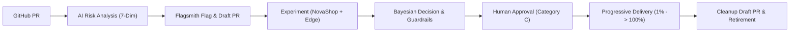
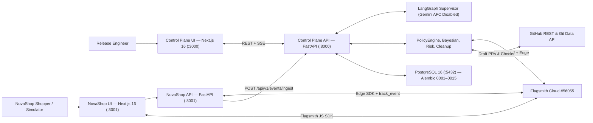

<div align="center">

# ReleaseGuard AI

**Your Autonomous AI Release Engineer — From Pull Request to Safe Production Release.**

[](https://www.python.org/)
[](https://fastapi.tiangolo.com/)
[](https://nextjs.org/)
[](https://www.postgresql.org/)
[](https://www.flagsmith.com/)
[](https://www.langchain.com/langgraph)
[](LICENSE)

ReleaseGuard AI closes the gap between **GitHub Pull Requests**, **Flagsmith Feature Flags & Experiments**, **Deterministic Bayesian Release Decisioning**, **Human-in-the-Loop Policy Governance**, **Progressive Delivery**, and **Automated Flag Cleanup**.

> Built for the **WeMakeDevs Flagsmith Hackathon — Track 02 (AI Agents and Feature Flags)**.  
> **3-Minute Demo Script:** [`docs/HACKATHON_VIDEO_SCRIPT.md`](docs/HACKATHON_VIDEO_SCRIPT.md) *(Demo video recording follows this exact walkthrough)*

</div>


---

## Table of Contents

- [1. Hero & Overview](#releaseguard-ai)
- [2. The Problem](#2-the-problem)
- [3. The Complete Workflow](#3-the-complete-workflow)
- [4. Three-Minute Demo](#4-three-minute-demo)
- [5. How We Used Flagsmith](#5-how-we-used-flagsmith)
- [6. AI Agents and Safety](#6-ai-agents-and-safety)
- [7. Bayesian Decision Engine](#7-bayesian-decision-engine)
- [8. Feature-Flag Cleanup](#8-feature-flag-cleanup)
- [9. Architecture](#9-architecture)
- [10. Quick Start](#10-quick-start)
- [11. Verification and Evidence](#11-verification-and-evidence)
- [12. Beyond the Core Demo](#12-beyond-the-core-demo)

---

## 2. The Problem

Modern engineering teams ship fast, but production releases still break at the seams between six disconnected tools:

1. **Code Review**: Risky checkout or payment changes slip into `main` without runtime protection.
2. **Feature-Flag Creation**: Wrapping code in flags manually is tedious and error-prone.
3. **Experimentation**: Teams deploy A/B tests without minimum sample gates or automated guardrail monitoring.
4. **Release Decisions**: Promoting winners is guesswork—or worse, an uncontrolled AI agent mutates production silently.
5. **Progressive Delivery**: Canary rollouts lack automated consecutive-breach pausing and rollback staging.
6. **Feature-Flag Cleanup**: Stale flags and dead code branches accumulate indefinitely after an experiment concludes.

**ReleaseGuard AI** unifies all six stages in one fail-closed control plane where **Gemini** reasons, **Python math** decides, **PolicyEngine** gates every mutation, and **Flagsmith + GitHub** execute verified changes.

---

## 3. The Complete Workflow



---

## 4. Three-Minute Demo

Follow the 6-screen `DemoPathBar` (`frontend/components/DemoPathBar.tsx`) or the full script in [`docs/HACKATHON_VIDEO_SCRIPT.md`](docs/HACKATHON_VIDEO_SCRIPT.md):

| Time | Screen & Route | Action |
| :---: | :--- | :--- |
| **0:00–0:20** | **Dashboard** (`/dashboard`) | Select repo + PR, enter natural-language release objective, launch AI Release Workflow. |
| **0:20–0:45** | **GitHub PR Analysis** (`/pull-requests`) | Inspect 7-dimension risk findings, Flagsmith flag recommendations, `PatchValidator` checks, and Draft PR (`draft=True`). |
| **0:45–1:15** | **Flagsmith Hub & NovaShop** (`/flagsmith`, `:3001`) | Inspect live Flagsmith Project `#56055` flags, segments, Identity Variation Explainer, and NovaShop live evaluation. |
| **1:15–1:45** | **Experiments** (`/experiments`) | Inspect Bayesian Beta-Binomial posteriors across Insufficient Data (`409`), Guardrail Breach (`409`), and Winning Variant (`202`). |
| **1:45–2:15** | **Approvals** (`/approvals`) | Request Category C promotion as Operator; approve as independent Reviewer (`requested_by_id != decided_by_id`). |
| **2:15–2:40** | **Progressive Delivery** (`/progressive-delivery`) | Track staged canary rollout (`1% -> 100%`) and live Flagsmith `verify_live_state()` readback. |
| **2:40–3:00** | **Release Report & Cleanup** (`/releases/[id]`) | Generate AST/TSX Cleanup Draft PR (`draft=True`), verify `409` pre-retirement gate, and retire flag safely. |

---

## 5. How We Used Flagsmith

Every Flagsmith capability listed below is implemented in source code and verified against **Flagsmith Cloud Project `#56055`** (`Development #120019`, `Staging #120029`, `Production #120020`):

| Capability | Implementation Details | Source Path |
|---|---|---|
| **Feature Flags (`STANDARD` & Kill Switches)** | 10 catalog flags (`checkout_v2`, kill switches, capability flags) synced with explicit per-flag safe fallbacks. | [`backend/app/services/flagsmith_service.py`](backend/app/services/flagsmith_service.py), [`demo-app/backend/app/features.py`](demo-app/backend/app/features.py) |
| **Multivariate Flags** | `checkout_experience_v2` (`#304842`), `recommendation_engine_v2` (`#304844`), `smart_product_search` (`#304845`), `new_payment_flow` (`#304846`) with `multivariate_feature_state_values` ID preservation. | [`backend/app/integrations/flagsmith_client.py`](backend/app/integrations/flagsmith_client.py) |
| **Environment Management (v1 + v2 Versioning)** | Inspects `use_v2_feature_versioning` per environment, creates draft versions, publishes `live_from`, and protects `production` behind `Category C` approval. | [`backend/app/integrations/flagsmith_client.py`](backend/app/integrations/flagsmith_client.py), [`backend/app/services/policy_engine.py`](backend/app/services/policy_engine.py) |
| **Identity Targeting & Segments** | Trait segments (`rg_internal_testers`, `rg_qa_and_beta`, `rg_returning_enterprise`) + Identity Variation Explainer (`POST /identities/`). | [`backend/app/api/v1/flagsmith_hub.py`](backend/app/api/v1/flagsmith_hub.py) |
| **Edge Evaluation** | Live Flagsmith Edge API (`https://edge.api.flagsmith.com/api/v1/`) + Flagsmith JS & Python SDKs in NovaShop. | [`demo-app/backend/app/flagsmith_service.py`](demo-app/backend/app/flagsmith_service.py), [`demo-app/frontend/`](demo-app/frontend/) |
| **Experiment Configuration** | Creates/starts/stops Flagsmith native experiments (`#503`–`#506`) with metrics (`metric_id: 484`). | [`backend/app/agents/tools/experiment_tools.py`](backend/app/agents/tools/experiment_tools.py) |
| **Event Tracking & Ingestion** | NovaShop emits `track_event` to Flagsmith + telemetry batches to `/api/v1/events/ingest` (`X-Ingest-Key` + `event_id` deduplication). | [`demo-app/backend/app/telemetry.py`](demo-app/backend/app/telemetry.py), [`backend/app/api/v1/events.py`](backend/app/api/v1/events.py) |
| **Management API & Live State Verification** | Fernet-encrypted `FLAGSMITH_ORG_TOKEN` client + post-mutation `verify_live_state()` readback + drift checks (`409 PreconditionDriftError`). | [`backend/app/agents/approval_executor.py`](backend/app/agents/approval_executor.py) |

---

## 6. AI Agents and Safety

ReleaseGuard AI runs inside `ReleaseGuardSupervisor` ([`backend/app/agents/supervisor.py`](backend/app/agents/supervisor.py)), a LangGraph `StateGraph` that separates **LLM reasoning** from **deterministic execution**:

- **Manual Function Calling Only (`AFC = Disabled`)**: Gemini (`google-genai`, default `gemini-3.5-flash-lite`) proposes tool calls; it never executes mutations directly.
- **Specialist Agents**:
  - `pr_agent` ([`pr_agent.py`](backend/app/agents/specialists/pr_agent.py)): Analyzes PR diffs with XML untrusted-input sandboxing, runs `PatchValidator` (`sha_ok`, `binary_ok`, syntax/AST checks), and opens **Draft PRs (`draft=True`)** only.
  - `flag_agent` ([`flag_agent.py`](backend/app/agents/specialists/flag_agent.py)): Provisions flags, runs Flag Health scans, and executes approved retirements.
  - `experiment_agent` ([`experiment_agent.py`](backend/app/agents/specialists/experiment_agent.py)): Evaluates Bayesian posteriors, guardrails, and winner promotion requests.
- **Pydantic v2 + `PolicyEngine` Gate** ([`policy_engine.py`](backend/app/services/policy_engine.py)):
  - `FORBIDDEN`: `github.merge_pr`, `github.force_push`, `github.push_main` — permanently blocked (`403`).
  - `Category A`: Read/analyze operations — auto-executed and audited.
  - `Category B`: Non-production updates & Draft PRs (`draft=True`).
  - `Category C`: Production toggles, rollouts, rollbacks, flag archival/deletion, and `promote_experiment_winner` — **always** require human approval.
- **Non-Self-Approval, Drift Checks & Live Readback** ([`approval_executor.py`](backend/app/agents/approval_executor.py)): Enforces `requested_by_id != decided_by_id`, `SHA-256` `action_hash`, single-use execution (`409` on replay), `expected_precondition` drift detection, and `verify_live_state()` readback.

---

## 7. Bayesian Decision Engine

[`backend/app/analytics/bayesian.py`](backend/app/analytics/bayesian.py) implements a **pure-Python Beta-Binomial engine** (`math`, `random.Random`, zero LLM involvement):

- **Conjugate Posteriors & Monte Carlo**: Models Control and Treatment with $\text{Beta}(1 + k, 1 + (n - k))$ over `50,000` draws (`BAYESIAN_MC_SAMPLES=50000`) to compute `prob_treatment_beats_control`, 95% credible intervals, and expected loss.
- **Minimum Sample Adequacy Gate (`min_exposures = 100`)**: Enforced on **unique deduplicated participants per arm**. Below `100`, returns `INSUFFICIENT_DATA` and blocks promotion (`409 EXPERIMENT_NOT_READY`).
- **Guardrail Enforcement**: Evaluates `payment_failed` and `checkout_abandoned` against `guardrail_max_error_rate` (`0.05`), `soft_error_delta` (`0.015`), and `hard_error_delta` (`0.030`). Breaches return `GUARDRAIL_BREACHED` and block promotion (`409 GUARDRAIL_BREACHED`).
- **Expected Loss Threshold**: Promotion requires `expected_loss_choose_treatment < 0.005`.
- **Known Limitation (Two-Arm Scope)**: `BayesianCountsInput` compares **one Control arm vs. one Treatment arm**. For 3-variant Flagsmith flags like `#503` (`control` / `one_page_checkout` / `simplified_checkout`), the engine compares `control` vs. `one_page_checkout`, placing unmapped third-arm events into `unattributed_events`.

---

## 8. Feature-Flag Cleanup

Once an experiment winner is promoted or a rollout reaches `100%`, ReleaseGuard AI prevents stale-flag debt via `FlagLifecycleStatus` (`0014_flag_lifecycle`):

```text
PROPOSED -> CREATED -> ACTIVE -> EXPERIMENTING -> PROMOTED -> CLEANUP_RECOMMENDED -> CLEANUP_PR_CREATED -> CLEANUP_APPROVED -> CLEANED_UP
```

1. **Dependency Blocker**: `transition_flag_post_promotion()` blocks `CLEANUP_RECOMMENDED` if partial rollouts (`<100%`) or active experiments remain in any environment.
2. **Real AST/TSX Cleanup Draft PR (`POST /api/v1/flag-health/{flag_id}/cleanup-pr`)**: Fetches matching Python/TS/TSX files from GitHub, removes the flag wrapper while preserving the winning branch, validates via `PatchValidator`, and opens a GitHub **Draft PR (`draft=True`)**.
3. **Pre-Retirement Gate (`POST /api/v1/flag-health/{flag_id}/request-delete`)**: Blocks retirement with `409 CLEANUP_PRECONDITION_UNMET` while `code_references` remain. Once clear, queues a `Category C` approval that archives the flag in Flagsmith and marks it `CLEANED_UP`.

---

## 9. Architecture



---

## 10. Quick Start

### Prerequisites
- Docker Desktop (running)
- Copy `.env.example` to `.env` and populate `GEMINI_API_KEY`, `SECRET_KEY`, `ENCRYPTION_KEY`, `AUTH_OPERATOR_*`, `EVENT_INGEST_KEY`, `FLAGSMITH_*`, and `GITHUB_PAT`.

### Start All 5 Services

```bash
cp .env.example .env
docker compose up -d --build
```

| Service | Container | Host Port | Purpose |
| :--- | :--- | :---: | :--- |
| **`frontend`** | `releaseguardai-frontend-1` | `3000` | ReleaseGuard AI Control Plane UI (`http://localhost:3000`) |
| **`backend`** | `releaseguardai-backend-1` | `8000` | FastAPI API, LangGraph Supervisor, PolicyEngine (`http://localhost:8000/docs`) |
| **`demo-frontend`** | `releaseguardai-demo-frontend-1` | `3001` | NovaShop Storefront UI (`http://localhost:3001`) |
| **`demo-backend`** | `releaseguardai-demo-backend-1` | `8001` | NovaShop API + Flagsmith Python SDK (`http://localhost:8001/api/health`) |
| **`postgres`** | `releaseguardai-postgres-1` | `5432` | PostgreSQL 16 (`0001`–`0015` Alembic migrations) |

---

## 11. Verification and Evidence

### Live vs. Synthetic vs. Deterministic Distinction

| Component | Provenance | Details |
|---|---|---|
| **GitHub PRs, Check Runs, Draft PRs** | **LIVE / VERIFIED** | Real API calls to `Pravin98651/ReleaseGaurd-AI` (zero auto-merges, `OPEN_GITHUB_PRS: 0` after teardown). |
| **Flagsmith Flags, Splits & Edge Evaluation** | **LIVE / VERIFIED** | Real Management v2 + Edge API calls against Project `#56055` (`Development #120019`; `Production #120020` untouched). |
| **NovaShop Shoppers & Event Cohorts** | **SIMULATED** | Deterministic synthetic cohorts (`synthetic_test_traffic: True`) routed through NovaShop + `/api/v1/events/ingest`. |
| **Bayesian Posteriors, Risk & Health Scores** | **VERIFIED (Deterministic)** | Pure-Python math executed on ingested PostgreSQL cohorts and repo ASTs. |
| **Manual Benchmark Baselines** | **ESTIMATED** | Manual engineering comparison times clearly tagged `ESTIMATED` alongside `VERIFIED_MEASURED` automated runs. |

### Proof Reports & Automated Test Suites

- **Phase 1 Live Proof Report (3 Repeatable Runs + Cohort Reconciliation):** [`docs/phase1-live-proof-report.md`](docs/phase1-live-proof-report.md)
- **Phase 2 Cleanup Lifecycle Proof Report (Real Draft PR `#17` + Gate):** [`docs/phase2-cleanup-proof-report.md`](docs/phase2-cleanup-proof-report.md)
- **Final Repository Audit & Readiness Report:** [`docs/HACKATHON_FINAL_AUDIT.md`](docs/HACKATHON_FINAL_AUDIT.md) · [`docs/HACKATHON_FINAL_READINESS_REPORT.md`](docs/HACKATHON_FINAL_READINESS_REPORT.md)
- **Known Limitations & Verification:** [`docs/verification-and-limitations.md`](docs/verification-and-limitations.md)
- **Screenshots:** [`docs/screenshots/`](docs/screenshots/) (`01-dashboard.png` through `07-novashop-demo.png`)

| Suite | Command | Observed Result |
|---|---|---|
| **Backend (`pytest`)** | `backend\.venv\Scripts\pytest.exe -q backend\tests` | **`167 passed`**, `0 failed` |
| **Demo App (`pytest`)** | `PYTHONPATH=demo-app/backend backend\.venv\Scripts\pytest.exe -q demo-app/tests` | **`15 passed`**, `0 failed` |
| **Frontend (`tsc`, `eslint`, `vitest`)** | `cd frontend && npx tsc --noEmit && npm run lint && npx vitest run` | **`11 files / 33 tests passed`**, `tsc` & `eslint` exit `0` |

---

## 12. Beyond the Core Demo

- **Multi-Repo Organization Intelligence (`/organization`)**: Directed dependency graphs and cross-repo blast radius assessment.
- **DORA & Productivity Benchmarking (`/metrics`, `backend/scripts/run_benchmark.py`)**: `VERIFIED_MEASURED` automated timings alongside `ESTIMATED` manual baselines.
- **Persistent Automation Scheduling (`/schedules`)**: Cron-based background Flag Health & experiment checks.
- **Notifications & Shareable Readiness Reports (`/integrations`, `/shared/[token]`)**: Slack/Discord alerts, GitHub Check Runs, and revocable read-only release reports.
- **Flag Health Scanner (`/flag-health`)**: Repo-wide AST/TSX stale-flag detection without truncation false positives.
