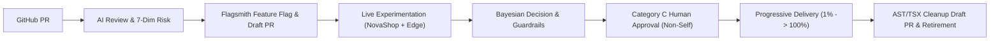
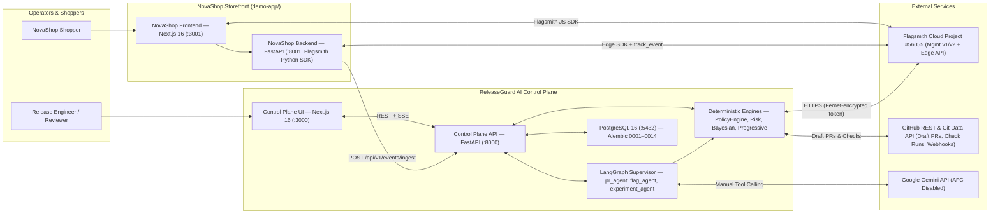
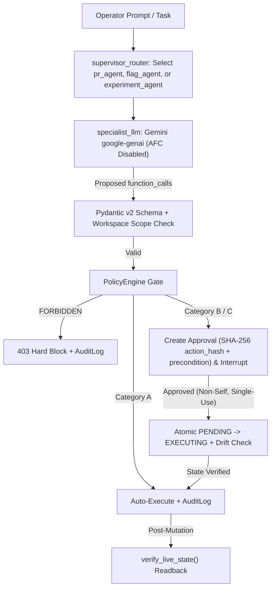
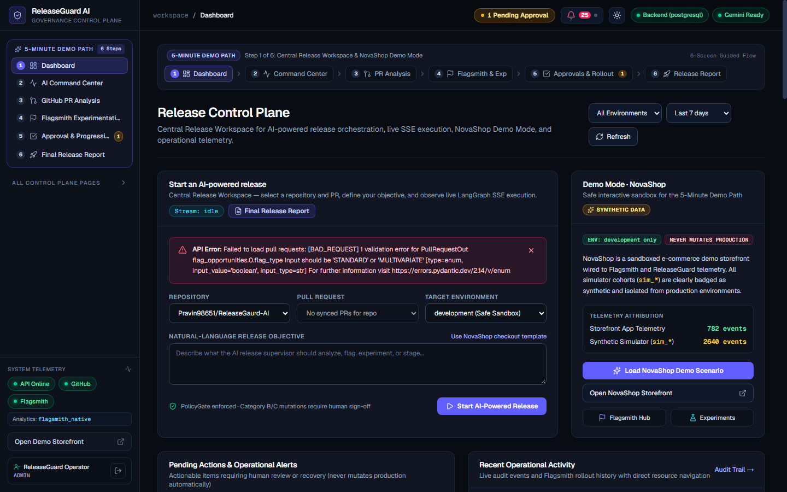
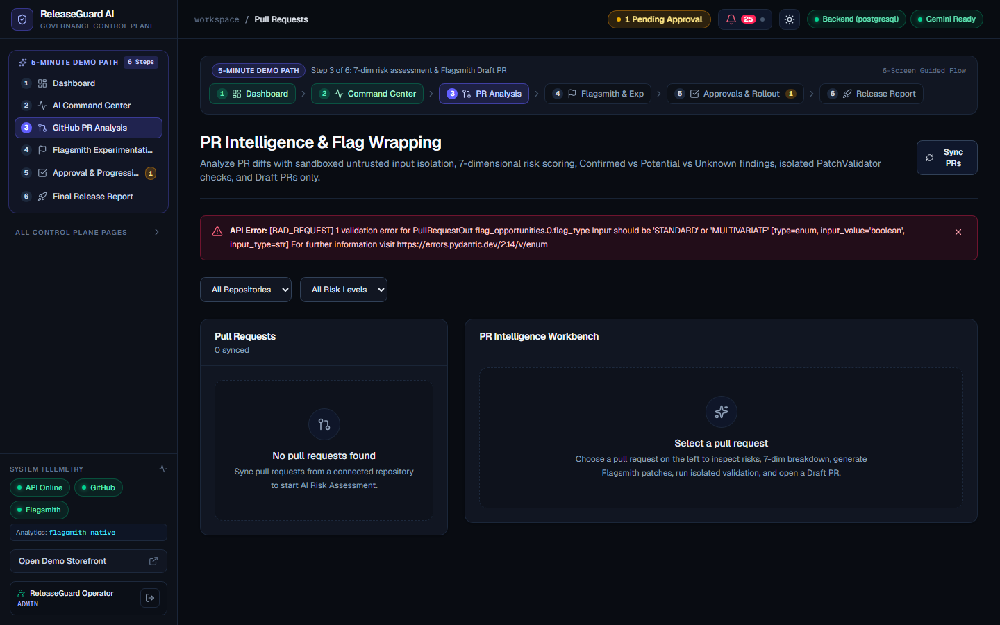
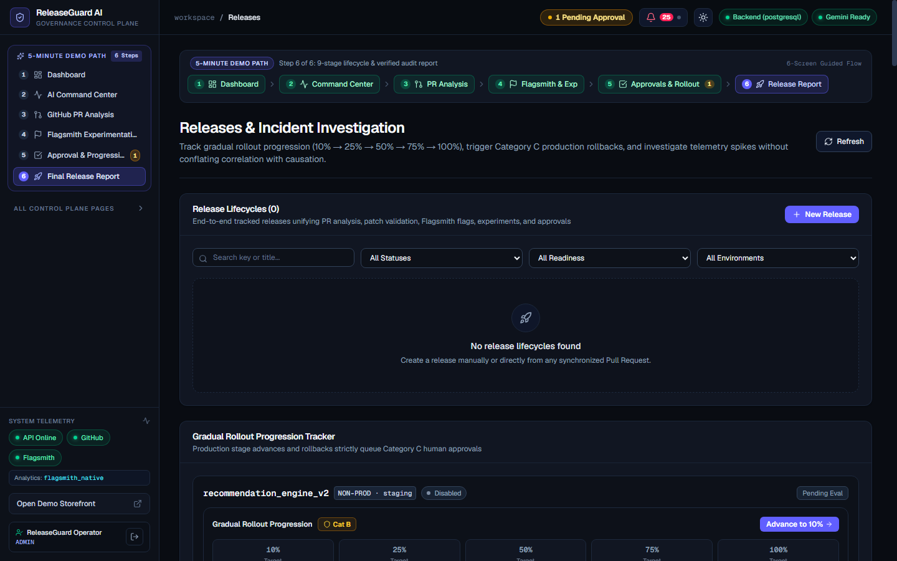
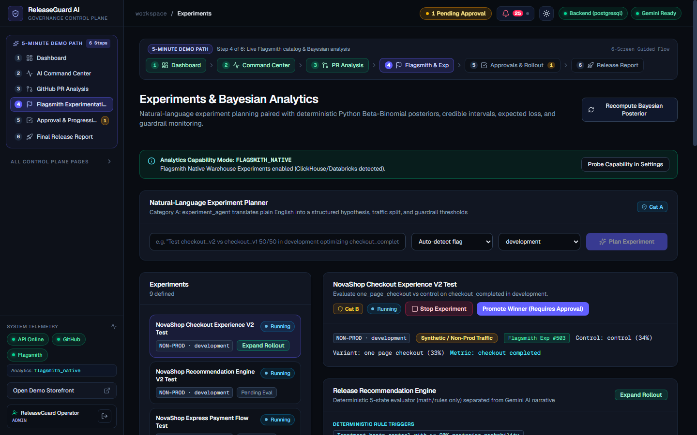
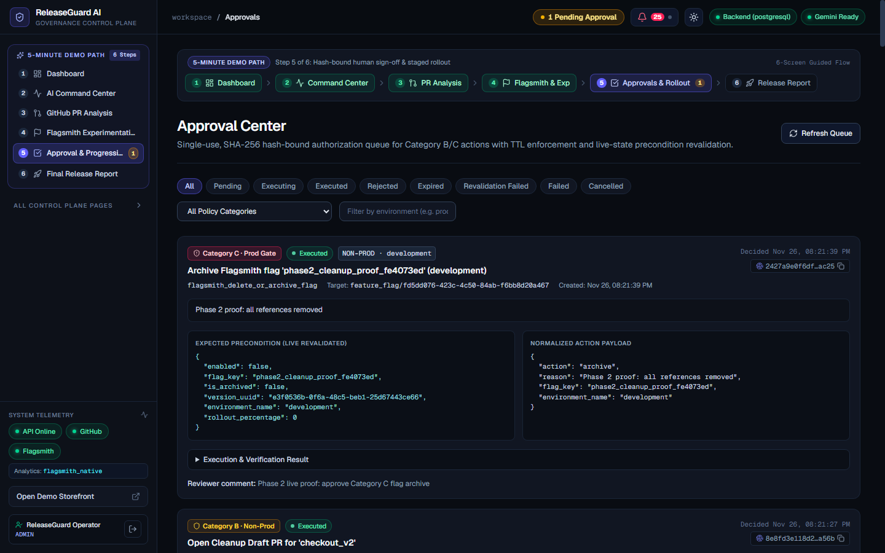
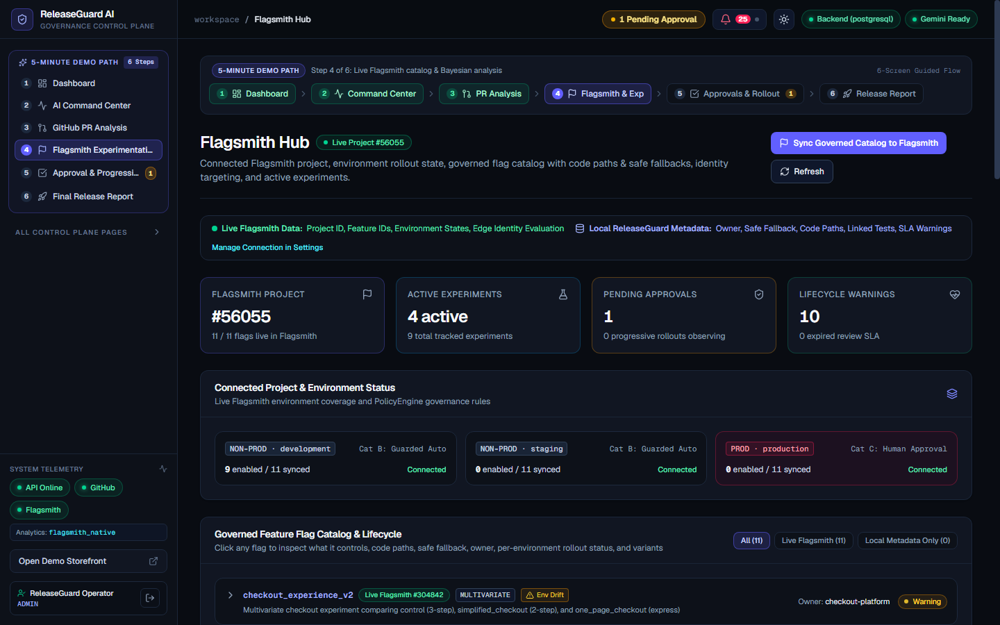
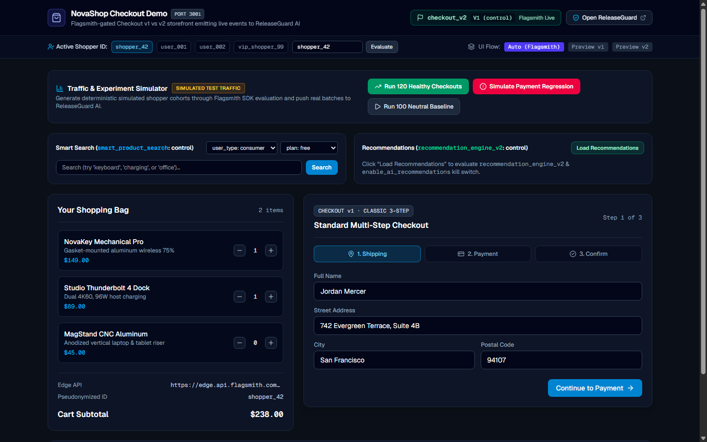

<div align="center">

# ReleaseGuard AI

**Your Autonomous AI Release Engineer — Ship Faster. Release Safer. Govern Every Flag & Experiment.**

[](https://www.python.org/)
[](https://fastapi.tiangolo.com/)
[](https://nextjs.org/)
[](https://www.postgresql.org/)
[](https://www.flagsmith.com/)
[](https://www.langchain.com/langgraph)
[](LICENSE)

Unifying **GitHub Pull Request Intelligence**, **Flagsmith Feature Flag Governance & Multivariate Experimentation**, **Pure-Python Bayesian Release Decisioning**, **Progressive Delivery**, and **Automated Flag Cleanup** behind an auditable **Human-in-the-Loop (HITL)** Policy Engine.

> Built for the **WeMakeDevs Flagsmith Hackathon — Track 02 (AI Agents and Feature Flags)**.

[Overview](#1-project-overview--problem-statement) · [Architecture & Flow](#2-end-to-end-architecture--6-screen-guided-flow) · [Flagsmith Inventory](#3-live-flagsmith-integration--provisioned-inventory) · [AI & Policy Safety](#4-multi-agent-orchestration--policy-safety) · [Bayesian Engine](#5-bayesian-beta-binomial-experimentation--guardrail-engine) · [Cleanup Lifecycle](#6-feature-flag-cleanup-lifecycle) · [Live Proof](#7-live-proof--verification-evidence) · [Quick Start](#9-quick-start--docker-compose-setup)

</div>

---

## Table of Contents

- [1. Project Overview & Problem Statement](#1-project-overview--problem-statement)
- [2. End-to-End Architecture & 6-Screen Guided Flow](#2-end-to-end-architecture--6-screen-guided-flow)
- [3. Live Flagsmith Integration & Provisioned Inventory](#3-live-flagsmith-integration--provisioned-inventory)
- [4. Multi-Agent Orchestration & Policy Safety](#4-multi-agent-orchestration--policy-safety)
- [5. Bayesian Beta-Binomial Experimentation & Guardrail Engine](#5-bayesian-beta-binomial-experimentation--guardrail-engine)
- [6. Feature-Flag Cleanup Lifecycle](#6-feature-flag-cleanup-lifecycle)
- [7. Live Proof & Verification Evidence](#7-live-proof--verification-evidence)
- [8. Screenshots & Visual Walkthrough](#8-screenshots--visual-walkthrough)
- [9. Quick Start & Docker Compose Setup](#9-quick-start--docker-compose-setup)
- [10. Beyond Core Demo](#10-beyond-core-demo)
- [11. Documentation Index & Hackathon Submission Links](#11-documentation-index--hackathon-submission-links)

---

## 1. Project Overview & Problem Statement

Modern engineering teams ship fast, but production releases still break at the seams between code review, feature flagging, experimentation, and cleanup:

- **Unflagged risky changes** ship straight to 100% of users, causing silent checkout or payment regressions.
- **Manual feature-flag boilerplate** slows developers down and introduces inconsistent fallback defaults.
- **Disconnected A/B analytics** make it easy to promote under-powered or guardrail-breaching variants.
- **Uncontrolled AI agents** cannot be trusted with production flags or `main` branch merges without deterministic guardrails.
- **Stale and orphaned flags** accumulate technical debt long after an experiment winner is promoted.

**ReleaseGuard AI** is an **Autonomous AI Release Engineer** built for the **WeMakeDevs Flagsmith Hackathon (Track 02)** that closes the entire release loop in one fail-closed control plane:

1. **Manual Function Calling Only (`AFC = Disabled`)**: Gemini (`google-genai`) proposes tool calls; it never executes them directly. Every call is intercepted by the LangGraph `StateGraph` supervisor, validated with Pydantic v2 schemas, checked against workspace scope, and gated by `PolicyEngine`.
2. **Deterministic Mathematics Outside the LLM**: Bayesian Beta-Binomial posteriors (`50,000` Monte Carlo draws), 95% credible intervals, expected loss, guardrail breach thresholds, 7-dimension risk scores, and Flag Health scores are computed strictly in Python (`backend/app/analytics/` and `backend/app/services/`).
3. **Never Auto-Merges & Never Silently Mutates Production**: `pr_agent` can only open **Draft PRs (`draft=True`)**; production flag toggles, rollouts, rollbacks, flag archives/deletions, and `promote_experiment_winner` **always** require `PolicyCategory.C` single-use human approval with non-self-approval (`requested_by_id != decided_by_id`).
4. **Pre-Execution Drift Check + Post-Mutation Readback**: Before executing any approved mutation, `approval_executor.py` verifies that live GitHub/Flagsmith state matches the captured `expected_precondition` (aborting with `409 PreconditionDriftError` on drift) and calls `verify_live_state()` immediately afterward.

---

## 2. End-to-End Architecture & 6-Screen Guided Flow

ReleaseGuard AI unifies a Next.js 16 Control Plane, a FastAPI + LangGraph backend, PostgreSQL 16 (`0001`–`0014` Alembic migrations, plus SQLite fallback), and the **NovaShop** live e-commerce demo application wired directly to Flagsmith Cloud.



### System Topology & Runtime Services



### 6-Screen Guided Demo Flow (`DemoPathBar`)

The Control Plane UI (`frontend/components/DemoPathBar.tsx`) guides judges and operators through 6 sequential screens (with advanced governance & intelligence routes tucked cleanly behind a collapsible sidebar drawer):

| Step | Screen & Route | What Happens |
| :---: | :--- | :--- |
| **1** | **Dashboard** (`/dashboard`) | Central release workspace + clearly badged NovaShop **Demo Mode** (`development` only) to launch or inspect an AI-powered release. |
| **2** | **AI Command Center** (`/command-center`) | Real-time SSE stream of `ReleaseGuardSupervisor` routing, specialist selection (`pr_agent`, `flag_agent`, `experiment_agent`), proposed tool calls, `PolicyEngine` gates, and approval interrupts. |
| **3** | **GitHub PR Analysis** (`/pull-requests`) | 10-category PR findings, 7-dimension risk breakdown, Flagsmith flag-opportunity deduplication, `PatchValidator` (`sha_ok`, `binary_ok`), and Draft PR creation (`draft=True`). |
| **4** | **Flagsmith & Experimentation** (`/flagsmith`, `/experiments`) | Live Flagsmith Project `#56055` catalog, trait targeting segments, Identity Variation Explainer, unique participants vs. raw exposures, and pure-Python Bayesian Beta-Binomial + guardrail evaluation. |
| **5** | **Approval & Progressive Delivery** (`/approvals`, `/progressive-delivery`) | Hash-bound (`SHA-256`) single-use `Category C` human sign-off (`requested_by_id != decided_by_id`) and staged canary rollout (`1% -> 5% -> 10% -> 25% -> 50% -> 100%`). |
| **6** | **Final Release Report & Flag Cleanup** (`/releases/[id]`) | 9-stage Visual Release Lifecycle, 6-class `EvidenceBadge` (`VERIFIED`, `OBSERVED`, `SIMULATED`, `AI_INFERRED`, `ESTIMATED`, `UNKNOWN`), and Screen 6 **Release Completion & Flag Cleanup** (Cleanup Draft PR + pre-retirement gate). |

---

## 3. Live Flagsmith Integration & Provisioned Inventory

ReleaseGuard AI integrates directly with **Flagsmith Cloud Project `#56055`** via `FlagsmithClient` (`backend/app/integrations/flagsmith_client.py`) and `FlagsmithGovernanceService` (`backend/app/services/flagsmith_service.py`):

- **Dual v1 + v2 Feature Versioning**: Automatically inspects `use_v2_feature_versioning` per environment, creates draft feature versions (`POST .../versions/`), preserves existing `id` keys on `multivariate_feature_state_values` updates, publishes versions (`live_from`), and verifies live state via `verify_live_state()`.
- **Environments**:
  - `Development`: **`#120019`** (active experimentation & live proof target)
  - `Staging`: **`#120029`**
  - `Production`: **`#120020`** (strictly protected; `Category C` human approval required for any mutation; untouched during automated proofs)
- **CLI Evaluation Bridge**: `@flagsmith/cli evaluate -e <env_key> --sdk-api-url https://edge.api.flagsmith.com --json` verified on host against Project `#56055` (`10/10` catalog flags).

### Provisioned Feature Flags (`10` Catalog Flags in Project `#56055`)

Every flag controls real executable code, carries an explicit per-flag safe fallback default (never a global fallback), and is never used as an authorization boundary:

| Flag Key | Category | Type | Safe Default | Variants | Linked Code Paths |
| :--- | :--- | :--- | :--- | :--- | :--- |
| `checkout_v2` | NovaShop App | `STANDARD` | `enabled=False, "v1"` | `v1`, `v2` | `demo-app/backend/app/checkout.py`, `NovaShopStorefront.tsx` |
| `checkout_experience_v2` *(Flag `#304842`)* | NovaShop App | `MULTIVARIATE` | `enabled=False, "control"` | `control`, `simplified_checkout`, `one_page_checkout` | `demo-app/backend/app/checkout.py`, `CheckoutV1Form.tsx`, `CheckoutV2Express.tsx` |
| `recommendation_engine_v2` *(Flag `#304844`)* | NovaShop App | `MULTIVARIATE` | `enabled=False, "control"` | `control`, `collaborative_v2`, `personalized_v2` | `demo-app/backend/app/features.py`, `NovaShopStorefront.tsx` |
| `smart_product_search` *(Flag `#304845`)* | NovaShop App | `MULTIVARIATE` | `enabled=False, "control"` | `control`, `ranked_v2`, `semantic_v2` | `demo-app/backend/app/features.py`, `NovaShopStorefront.tsx` |
| `new_payment_flow` *(Flag `#304846`)* | NovaShop App | `MULTIVARIATE` | `enabled=False, "control"` | `control`, `express_token_v2` | `demo-app/backend/app/checkout.py`, `features.py` |
| `enable_ai_recommendations` | Kill Switch | `STANDARD` | `enabled=True` | `true` / `false` | Forces deterministic popularity sort when off |
| `enable_payment_v2` | Kill Switch | `STANDARD` | `enabled=True` | `true` / `false` | Forces classic card authorization gateway when off |
| `enable_new_search_backend` | Kill Switch | `STANDARD` | `enabled=True` | `true` / `false` | Forces simple substring search when off |
| `enable_ai_pr_review` | Capability | `STANDARD` | `enabled=True` | `true` / `false` | Gates optional Gemini PR enrichment |
| `enable_progressive_delivery` | Capability | `STANDARD` | `enabled=True` | `true` / `false` | Gates automated rollout orchestration |

### Trait Targeting Segments & Native Flagsmith Experiments (`#503`–`#506`)

- **Provisioned Trait Segments (`Project #56055`)**:
  - `rg_internal_testers`: `is_internal_tester == "true"` OR `user_type == "internal"`
  - `rg_qa_and_beta`: `user_type == "qa"` OR `subscription_plan == "beta"`
  - `rg_returning_enterprise`: `subscription_plan == "enterprise"`
- **Identity Variation Explainer (`POST /api/v1/flagsmith/identities/explain`)**: Evaluates an identity twice against Flagsmith Edge `POST /identities/` with traits (`user_type`, `subscription_plan`, `app_version`, `is_internal_tester`, `organization_id`) and verifies `consistent_on_repeat_evaluation: true` (`10/10` flags).
- **Active Native Experiments in `Development` (`#120019`)**:

| Live Exp ID | Experiment Name | Flagsmith Flag | Variants | Primary Metric | Guardrails |
| :---: | :--- | :--- | :--- | :--- | :--- |
| **`#503`** | NovaShop Checkout Experience V2 Test | `checkout_experience_v2` (`#304842`) | `control` (34%), `simplified_checkout` (33%), `one_page_checkout` (33%) | `checkout_completed` (`metric_id: 484`) | `payment_failed`, `checkout_abandoned` |
| **`#504`** | NovaShop Recommendation Engine V2 Test | `recommendation_engine_v2` (`#304844`) | `control`, `collaborative_v2`, `personalized_v2` | `product_clicked_from_recommendation` | `payment_failed` |
| **`#505`** | NovaShop Smart Product Search Test | `smart_product_search` (`#304845`) | `control`, `ranked_v2`, `semantic_v2` | `search_result_clicked` | `checkout_abandoned` |
| **`#506`** | NovaShop Express Payment Flow Test | `new_payment_flow` (`#304846`) | `control`, `express_token_v2` | `payment_completed` | `payment_failed` |

---

## 4. Multi-Agent Orchestration & Policy Safety

Every AI workflow executes inside `ReleaseGuardSupervisor` (`backend/app/agents/supervisor.py`), a LangGraph `StateGraph` that strictly separates **LLM reasoning** from **authorized tool execution**:



### Key Safety Guarantees

- **Specialist Agents**:
  - **`pr_agent`**: Analyzes PR diffs (with XML untrusted-input sandboxing), normalizes risk/flag schemas, runs `PatchValidator` (`sha_ok`, `binary_ok`, syntax/AST checks against `head_sha`), and opens **Draft PRs (`draft=True`)**—never merges or pushes to `main`.
  - **`flag_agent`**: Provisions/updates Flagsmith flags, runs Flag Health scans, and executes approved flag transitions or retirements.
  - **`experiment_agent`**: Evaluates Bayesian posteriors, checks guardrails, refreshes Flagsmith experiment results, and stages winner promotions.
- **`PolicyEngine` Categories**:
  - **`FORBIDDEN`**: `github.merge_pr`, `github.force_push`, `github.push_main`, `policy.bypass_hash`, `fs.modify_host` — permanently rejected (`403`).
  - **`Category A`**: Read/analyze operations (`PatchValidator`, PR analysis, Flagsmith reads, Flag Health scan, Bayesian analysis) — auto-executed and audited.
  - **`Category B`**: Non-production flag/segment updates and creating Draft PRs (`draft=True`) — configurable confirmation (`CATEGORY_B_REQUIRES_CONFIRMATION`).
  - **`Category C`**: **Any** `production` toggle, percentage rollout, rollback, flag deletion/archive, and `promote_experiment_winner` — **always** requires explicit human approval.
- **Non-Self-Approval & Single-Use Execution**: `approvals` enforces `requested_by_id != decided_by_id` and binds each request to a `SHA-256` `action_hash` + `900s` TTL; replaying an executed approval returns `409 Conflict`.

---

## 5. Bayesian Beta-Binomial Experimentation & Guardrail Engine

`backend/app/analytics/bayesian.py` implements a **pure-Python Beta-Binomial analytics and guardrail engine** (zero LLM involvement, deterministic `random.Random` + `math`, Pydantic v2 validated):

1. **Conjugate Beta-Binomial Posteriors**: Models conversion rates for Control and Treatment with $\text{Beta}(\alpha_0 + k, \beta_0 + (n - k))$ ($\alpha_0 = 1.0, \beta_0 = 1.0$ default) and runs **`50,000` Monte Carlo draws** (`BAYESIAN_MC_SAMPLES=50000`) to compute:
   - `prob_treatment_beats_control`
   - `absolute_lift_mean` & `relative_lift_mean` with **95% Credible Intervals**
   - `expected_loss_choose_treatment` & `expected_loss_choose_control`
2. **Minimum Sample Adequacy Gate (`min_exposures = 100`)**: Below `100` exposures per arm, the engine returns `INSUFFICIENT_DATA` (`is_adequate: false`) and `POST /api/v1/experiments/{id}/promote-winner` blocks promotion with **`409 EXPERIMENT_NOT_READY`**.
3. **Guardrail Breach Blocking**: Evaluates `payment_failed` and `checkout_abandoned` error/abandonment rates against `guardrail_max_error_rate` (`0.05`), `soft_error_delta` (`0.015`), and `hard_error_delta` (`0.030`). When breached, it returns `GUARDRAIL_BREACHED` (`Recommend Rollback`) and blocks promotion with **`409 GUARDRAIL_BREACHED`**.
4. **`VARIANT_WINS` Promotion**: Only when sample size is adequate, guardrails are clean, and expected loss is below `max_expected_loss` (`0.005`) does `promote-winner` return `202 Accepted` and queue a **Category C** human approval.

---

## 6. Feature-Flag Cleanup Lifecycle

Once an experiment winner is promoted or a progressive rollout reaches `100%`, ReleaseGuard AI manages the full retirement lifecycle via `FlagLifecycleStatus` (`backend/app/models/enums.py`, Alembic `0014_flag_lifecycle`):

```text
PROPOSED -> CREATED -> ACTIVE -> EXPERIMENTING -> PROMOTED -> CLEANUP_RECOMMENDED -> CLEANUP_PR_CREATED -> CLEANUP_APPROVED -> CLEANED_UP
```

- **Post-Promotion Dependency Check**: `transition_flag_post_promotion()` inspects active experiments, rollouts, and environment dependencies—transitioning the flag to `CLEANUP_RECOMMENDED` when safe, or staying `PROMOTED` with explicit `blockers` if unresolved dependencies remain.
- **Real AST/TSX Cleanup Draft PRs (`POST /api/v1/flag-health/{flag_id}/cleanup-pr`)**: `pr_agent.generate_cleanup_patch_payload()` fetches real matching Python/TS/TSX files from GitHub, preserves the winning variant behavior, removes obsolete branches/fallbacks and flag evaluation calls, validates the patch via `PatchValidator` against `head_sha`, and opens a real GitHub **Draft PR (`draft=True`)**.
- **Pre-Retirement Gate (`POST /api/v1/flag-health/{flag_id}/request-delete`)**: Blocks flag retirement with **`409 CLEANUP_PRECONDITION_UNMET`** if code references still exist and no cleanup PR is merged. Once ready, it queues a **Category C** approval for the requested target environment (never hardcoding `production`), which archives the flag in Flagsmith and marks it `CLEANED_UP`.

---

## 7. Live Proof & Verification Evidence

### Phase 1 Live End-to-End Proof (3 Repeatable Runs)

Executed via [`backend/scripts/phase1_live_proof.py`](backend/scripts/phase1_live_proof.py) (`--runs 3`) and documented in [`docs/phase1-live-proof-report.md`](docs/phase1-live-proof-report.md) against Docker Compose + live GitHub (`Pravin98651/ReleaseGaurd-AI`) + live Flagsmith (`#56055` Dev `#120019`):

- **3/3 Repeatable Runs Completed** (`375.95s`, `368.40s`, `358.55s`), creating and analyzing real GitHub PRs `#11`, `#12`, `#13` (`risk_score=95`, 7-dim score `37`, 64-bit DX comment IDs `7193669365`, `7193817422`, `7193957150`).
- **All 3 Bayesian Scenarios Verified Live per Run**:
  - **Scenario C (`25/arm`)**: `INSUFFICIENT_DATA` -> `409 EXPERIMENT_NOT_READY`
  - **Scenario B (`110/arm`, `0.1636` vs `0.0091` error rate)**: `GUARDRAIL_BREACHED` -> `409 GUARDRAIL_BREACHED`
  - **Scenario A (`120/arm`, `14` vs `34` conversions)**: `VARIANT_WINS` (`P=0.99934`, expected loss `7e-06`) -> `202 Accepted`
- **Category C Non-Self-Approval & Replay Protection**: Operator (`operator@releaseguard.local`) requested promotion; independent reviewer (`reviewer@releaseguard.local`) approved; replay returned `409 Conflict`; Flagsmith Management + Edge readback confirmed `one_page_checkout` at `100%` before cleanly restoring Dev `#503` to `34/33/33` and closing demo PRs (`OPEN_GITHUB_PRS: 0`, Production `#120020` & `main` untouched).

### Phase 2 Cleanup Lifecycle Proof

[`backend/scripts/phase2_cleanup_proof.py`](backend/scripts/phase2_cleanup_proof.py) verifies post-promotion dependency checking, real AST/TSX cleanup Draft PR creation (`draft=True`) on GitHub, `409 CLEANUP_PRECONDITION_UNMET` blocking when code references remain, and Category C approval execution -> `CLEANED_UP` with clean teardown (`OPEN_GITHUB_PRS: 0`).

### Automated Test Suites (Observed Post-Edit Results)

| Suite | Command | Result |
| :--- | :--- | :--- |
| **Backend (`pytest`)** | `backend\.venv\Scripts\pytest.exe -q backend\tests` | **`166 passed`**, `0 failed` |
| **Demo App (`pytest`)** | `PYTHONPATH=demo-app/backend backend\.venv\Scripts\pytest.exe -q demo-app/tests` | **`15 passed`**, `0 failed` |
| **Frontend (`tsc`, `eslint`, `vitest`)** | `cd frontend && npx tsc --noEmit && npm run lint && npx vitest run` | **`11 test files / 33 tests passed`**, `tsc` & `eslint` exit `0` |
| **Frontend Production Build** | `docker compose up -d --build frontend` | `next build` **`32/32` routes**, HTTP `200` on `:3000` |

---

## 8. Screenshots & Visual Walkthrough

All screenshots below were captured at `1440x900` from the live authenticated Docker Compose stack (`http://localhost:3000` and `http://localhost:3001`):

### 1. Control Plane Dashboard (`/dashboard`)


### 2. GitHub PR Analysis & Risk Breakdown (`/pull-requests`)


### 3. Release Workspace & 9-Stage Lifecycle (`/releases`)


### 4. Bayesian Experimentation & Guardrails (`/experiments`)


### 5. Category C Human Approval Gate (`/approvals`)


### 6. Flagsmith Command Center (`/flagsmith`)


### 7. NovaShop Live Demo Storefront (`http://localhost:3001/`)


---

## 9. Quick Start & Docker Compose Setup

### Prerequisites
- Docker Desktop (running)
- `.env` copied from [`.env.example`](.env.example)

### 1. Configure Environment (`.env`)

```bash
cp .env.example .env
```

Set at minimum:
- **AI Supervisor**: `GEMINI_API_KEY` (and `GEMINI_MODEL=gemini-3.5-flash-lite`)
- **Security & Auth**: `SECRET_KEY` (32+ chars), `ENCRYPTION_KEY` (Fernet key), `REQUIRE_AUTH`, `AUTH_OPERATOR_EMAIL`, `AUTH_OPERATOR_PASSWORD`, `EVENT_INGEST_KEY`
- **Flagsmith**: `FLAGSMITH_ORG_TOKEN`, `FLAGSMITH_PROJECT_ID`, `FLAGSMITH_DEV_ENV_KEY`, `FLAGSMITH_STAGING_ENV_KEY`, `FLAGSMITH_PROD_ENV_KEY`
- **NovaShop Demo**: `NEXT_PUBLIC_FLAGSMITH_ENV_KEY`, `FLAGSMITH_SERVER_ENV_KEY`, `RELEASEGUARD_API_URL`, `RELEASEGUARD_INGEST_KEY`
- **GitHub**: `GITHUB_PAT` (or GitHub OAuth / GitHub App credentials)

### 2. Start All 5 Services

```bash
docker compose up -d --build
```

| Service | Container | Host Port | Purpose |
| :--- | :--- | :---: | :--- |
| **`frontend`** | `releaseguardai-frontend-1` | `3000` | ReleaseGuard AI Control Plane UI (`http://localhost:3000`) |
| **`backend`** | `releaseguardai-backend-1` | `8000` | FastAPI API, LangGraph Supervisor, PolicyEngine, Scheduler (`http://localhost:8000/docs`) |
| **`demo-frontend`** | `releaseguardai-demo-frontend-1` | `3001` | NovaShop Storefront UI (`http://localhost:3001`) |
| **`demo-backend`** | `releaseguardai-demo-backend-1` | `8001` | NovaShop API + Flagsmith Python SDK (`http://localhost:8001/api/health`) |
| **`postgres`** | `releaseguardai-postgres-1` | `5432` | PostgreSQL 16 (`0001`–`0014` Alembic migrations) |

---

## 10. Beyond Core Demo

Beyond the 6-screen core release flow, ReleaseGuard AI ships a full suite of production governance capabilities:

- **Developer Productivity Benchmarking (`/metrics`, `backend/scripts/run_benchmark.py`)**: Persists `VERIFIED_MEASURED` automated Flagsmith workflow timings (e.g., Workflow B `flag_setup`: `mean 5.018 s` across 3 live trials in `development`) alongside clearly labelled `ESTIMATED` manual baselines—never fabricating savings.
- **Flag Health Scanner (`/flag-health`, `backend/app/analytics/flag_health.py`)**: Scans repository codebases without truncation false positives to detect stale, orphaned, or unlinked flags and compute per-flag health scores (`0`–`100`).
- **Progressive Delivery Canary Rollouts (`/progressive-delivery`)**: Stage-by-stage traffic progression (`1% -> 5% -> 10% -> 25% -> 50% -> 100%`) with minimum observation windows, consecutive guardrail breach auto-pausing, and Category C rollback staging.
- **Immutable Audit Logs (`/audit-logs`)**: Full actor, action, `action_hash`, precondition, and live readback trail with JSON/CSV export.
- **NovaShop Live Storefront (`demo-app/`)**: Real Next.js + FastAPI e-commerce app wired to Flagsmith JS & Python SDKs (`checkout_v2`, `checkout_experience_v2`, `recommendation_engine_v2`, `smart_product_search`, `new_payment_flow`) with deterministic traffic simulation and kill-switch testing.
- **Multi-Repo Organization Intelligence & DX (`/organization`, `/integrations`, `/shared/[token]`)**: Directed dependency graphs, cross-repo blast radius assessment, GitHub Check Runs, Slack/Discord alerts, and revocable shareable readiness reports.

---

## 11. Documentation Index & Hackathon Submission Links

- **Live Proof & Setup**: [Phase 1 Live Proof Report](docs/phase1-live-proof-report.md) · [Setup Guide](docs/setup.md) · [Demo Workflow](docs/demo-workflow.md) · [Verification & Limitations](docs/verification-and-limitations.md) · [NovaShop README](demo-app/README.md)
- **Flagsmith Integration Reports**: [Audit](docs/flagsmith/flagsmith-current-state-audit.md) · [Catalog](docs/flagsmith/feature-flag-catalog.md) · [Architecture](docs/flagsmith/flagsmith-integration-architecture.md) · [Experiments](docs/flagsmith/experiment-implementation.md) · [Targeting](docs/flagsmith/identity-and-targeting.md) · [Governance](docs/flagsmith/approval-and-governance.md) · [Automated Testing](docs/flagsmith/automated-flag-testing.md) · [Live Results](docs/flagsmith/experiment-test-results.md) · [Time Savings](docs/flagsmith/developer-time-savings.md) · [Hackathon Compliance](docs/flagsmith/flagsmith-hackathon-compliance.md)
- **Architecture & Phase Specs**: [Architecture](docs/architecture.md) · [API & Tools](docs/api.md) · [DB & Policies](docs/database-and-policies.md) · [Release Lifecycle](docs/release-lifecycle-design.md) · [Command Center](docs/agent-command-center-design.md) · [Risk Engine](docs/intelligent-release-risk-design.md) · [Progressive Delivery](docs/progressive-delivery-design.md) · [Release Intelligence](docs/release-intelligence-design.md) · [DX Integration](docs/phase6-dx-integration-design.md) · [Multi-Repo](docs/phase7-multi-repo-design.md)
- **Reliability & Reality Audits**: [Reality Scorecard](docs/application-reality-audit/application-scorecard.md) · [Final Reliability Report](docs/reliability/final-reliability-report.md)
- **License**: [MIT License](LICENSE)
