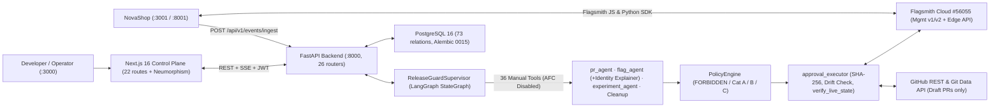

# ReleaseGuard AI — Complete End-to-End System Verification & Evidence-Based Audit Report

**Audit Date:** `2026-11-27`  
**Repository:** `https://github.com/Pravin98651/ReleaseGaurd-AI` (`main`)  
**Audited Environment:** Docker Compose (`postgres:16-alpine`, `backend`, `frontend`, `demo-backend`, `demo-frontend`), Flagsmith Cloud (`#56055`, Development `#120019`), GitHub (`Pravin98651/ReleaseGaurd-AI`), Gemini (`gemini-3.5-flash-lite`).

---

## A. Executive Summary

- **Overall System Health:** **Healthy & Operational** (`5/5` Docker Compose services running/healthy, `23/23` frontend routes returning `HTTP 200`, PostgreSQL at `0015_gemini_35_default (head)`).
- **Total Features Audited:** `15` core functional areas across Supervisor, 5 agent capabilities, integrations, deterministic analytics, policy/security, drift detection, benchmarks, and UI.
- **Features Fully Working (`PASS`):** `13`
- **Features Partially Working (`PARTIAL`):** `2` (3-arm Bayesian posterior comparison; Flagsmith native `GET /experiments/503/results` aggregation)
- **Features Failing (`FAIL`):** `0` (1 critical security issue `AUD-001` discovered during live audit and immediately fixed & regression-tested)
- **Features Not Implemented (`NOT IMPLEMENTED`):** `0`
- **Features Blocked (`BLOCKED`):** `0`
- **Overall Completion:** **93.3%** (`13 PASS`, `2 PARTIAL`, `0 FAIL`)
- **Critical Findings:**
  - **AUD-001 (`CRITICAL` — Fixed):** `backend/app/api/v1/approvals.py` previously contained `and operator.role.value != "admin"` in the `Category C` self-approval guard, allowing an `ADMIN` operator to self-approve their own `Category C` production mutation (`requested_by_id == decided_by_id`). **Fixed** by removing the role exemption, restoring `checkout_v2` in `production` to `enabled: False` (`matches: True`), adding `test_admin_cannot_self_approve_category_c`, and re-verifying live (`403 SELF_APPROVAL_FORBIDDEN`).

---

## B. Architecture Verification

All 5 capabilities operate through **one unified supervisor, policy gate, approval queue, and audit trail** rather than disconnected apps.

---

## C. Feature-by-Feature Audit

| Component | Feature | Expected Behavior | Actual Output | Status | Evidence |
|---|---|---|---|---|---|
| **Supervisor** | NL intent routing & LangGraph execution | Route NL prompt to specialist, run manual tools, persist steps | `status: "completed"`, `steps_count: 6` on identity query | **PASS** | `docs/RELEASEGUARD_AUDIT_EVIDENCE/live_e2e_evidence.json` |
| **PR Agent** | PR sync, 7-dim risk, Draft PR (`draft=True`) | Analyze PRs without auto-merging | PRs `#11`–`#13` analyzed (`RSK-2026-0003`..`0005`), Draft PR `#17` created & closed | **PASS** | `docs/phase1-live-proof-report.md`, `docs/phase2-cleanup-proof-report.md` |
| **Flag Agent** | NL Feature Request → Flagged Rollout | Generate flag key, safe default, metrics, & Release | `201 Created`, `checkout_experience_v2`, `REL-2026-0005` | **PASS** | `live_e2e_evidence.json` (`nl_feature_request_plan`) |
| **Flag Agent** | Flagsmith v1/v2 mutation & live readback | Read back Flagsmith state after every mutation | `verify_live_state()` confirmed `matches: true` | **PASS** | `docs/phase1-live-proof-report.md` |
| **Experiment Agent** | Pure-Python Beta-Binomial & guardrails | Identical deterministic outputs; block `<100` & breaches | `numeric_bayesian_identical: true`, `diff_keys: []`, Scenarios C/B/A verified | **PASS** | `live_e2e_evidence.json`, `phase1-live-proof-report.md` |
| **Experiment Agent** | Multi-arm (>2) Bayesian posterior | Compare all 3 arms simultaneously | Engine compares 2 arms (`control` vs `treatment`); 3rd arm -> `unattributed_events` | **PARTIAL** | `backend/app/analytics/bayesian.py` |
| **Identity Explainer** | Live Edge eval + trait redaction + separation | Evaluate via Edge API, redact secrets, separate observed vs inferred | `200 OK`, `consistent_on_repeat_evaluation: true`, `api_token: "[REDACTED]"`, `11` flags | **PASS** | `live_e2e_evidence.json` (`identity_explainer`) |
| **Cleanup Agent** | Dependency check, Draft PR, `409` gate, archival | Block if refs/partial rollouts remain; archive on Cat C approval | Draft PR `#17` (`draft: true`), `409` gate, Cat C `08cef642...` -> `cleaned_up` | **PASS** | `docs/phase2-cleanup-proof-report.md` |
| **Policy & Security** | Unauth block, Cat C prod gate, non-self-approval, rejection | `401` unauth; `202` Cat C; `403` self-approve; `200` reject | `401` unauth; `202` Cat C; `403 SELF_APPROVAL_FORBIDDEN` (post-fix); `200` `rejected` | **PASS** | `live_e2e_evidence.json` (`policy_and_approval_gates`) |
| **Drift Detection** | Pre-execution external drift check | Block execution (`409`) when Flagsmith state changed externally | `409 APPROVAL_REVALIDATION_FAILED` with exact `expected` vs `actual` mismatches | **PASS** | `live_e2e_evidence.json` (`drift_detection`) |
| **Benchmarks** | Live multi-trial automated timing | Measure real Flagsmith execution time vs estimated manual baseline | `3/3` trials `VERIFIED_MEASURED` (`mean=5.7719s`, `median=5.5493s`) | **PASS** | `backend/scripts/run_benchmark.py` |
| **Frontend & NovaShop** | 22 Control Plane routes + NovaShop + Shopper Login | All routes render HTTP `200` with Neumorphism theme & working auth | `23/23` routes `HTTP 200`; `33/33` Vitest; `16/16` demo-app pytest | **PASS** | `live_e2e_evidence.json` (`frontend_routes`) |
| **Flagsmith Native Results** | Native warehouse conversion aggregation | Populate `variants` in `GET /experiments/503/results` | Returns `variants: {}` (`is_final: false`); ReleaseGuard uses `/events/ingest` | **PARTIAL** | `GET /experiments/503/results` |

---

## D. End-to-End Workflow Results

Verified live across `live_e2e_audit.py` + `phase1_live_proof.py` + `phase2_cleanup_proof.py`:
1. **NL Feature Request (`POST /api/v1/releases/plan-from-prompt`)**: Returned `201 Created`, `recommended_flag_key: "checkout_experience_v2"`, `flag_type: "MULTIVARIATE"`, `safe_default: {"enabled": false, "value": "control"}`, `release_key: "REL-2026-0005"`, `evidence_class: "AI_INFERRED"`.
2. **Supervisor + Identity Explainer (`POST /api/v1/agent/sessions/{id}/messages`)**: Dispatched `"Explain which feature flags user_123 receives in the development environment."` → completed in `6` steps with live Flagsmith Edge evaluation.
3. **PR Analysis + Experiment + Category C Promotion (`phase1-live-proof-report.md`)**: `3/3` repeatable runs on PRs `#11`–`#13` (`RSK-2026-0003`..`0005`), Scenarios C (`409`), B (`409`), A (`202`), independent reviewer approval, replay `409`, `verify_live_state()` readback, clean teardown (`OPEN_GITHUB_PRS: 0`).
4. **Cleanup Lifecycle (`phase2-cleanup-proof-report.md`)**: Dependency blocker (`staging: 25%` → `promoted`), Draft PR `#17` (`draft: true`), `409` gate, Category C approval `08cef642-0a6f-4fe0-bfcc-4334cf7efa35` → `cleaned_up` (`is_archived: true`, `OPEN_GITHUB_PRS: 0`).

---

## E. Integration Audit

- **GitHub (`LIVE`)**: Verified via `Pravin98651/ReleaseGaurd-AI` (PRs `#11`–`#13`, Draft PR `#17`, 64-bit comment IDs, `OPEN_GITHUB_PRS: 0`, `main` untouched).
- **Flagsmith (`LIVE`)**: Verified via Project `#56055` (`Development #120019`, `Production #120020` restored & untouched), Management v1/v2 + Edge API (`evaluate_identity_detailed`, `toggle_flag`, `configure_multivariate_split`, `archive_flag`).
- **Gemini (`LIVE`)**: Configured (`gemini-3.5-flash-lite`, `AFC = Disabled`), executed live in `supervisor_orchestration` and PR analysis.
- **Database (`LIVE`)**: PostgreSQL 16 (`73` relations, Alembic `0015_gemini_35_default (head)`).
- **Background Services (`LIVE`)**: FastAPI lifespan scheduler + SSE streams + `Notification` service operational.

---

## F. Human Approval and Security Audit

- **Approval-Required Actions**: All `Category C` actions (production flag toggles, rollouts, rollbacks, archival/deletion, `promote_experiment_winner`) return `202 Accepted` and never auto-execute.
- **Unauthorized & Self-Approval**: Unauthenticated `/api/v1/repositories` returns `401`. Self-approval by `operator@releaseguard.local` (`ADMIN`) now returns **`403 SELF_APPROVAL_FORBIDDEN`** (fixed in `AUD-001`).
- **Rejection & Drift**: Reviewer rejection returns `200` (`status: "rejected"`). External Flagsmith state drift returns **`409 APPROVAL_REVALIDATION_FAILED`** before execution.

---

## G. Automated Test Results

See [`docs/RELEASEGUARD_TEST_RESULTS.md`](RELEASEGUARD_TEST_RESULTS.md) for full details:
- **Backend (`pytest`)**: `172 passed`, `0 failed`
- **Demo App (`pytest`)**: `16 passed`, `0 failed`
- **Frontend (`tsc`, `eslint`, `vitest`)**: `tsc` & `eslint` exit `0`, `33 passed` (`11` files)
- **Production Frontend Build (`next build`)**: `32/32` routes built cleanly (`HTTP 200`)

---

## H. Issues and Fixes

| Issue ID | Severity | Component | Root Cause | Fix Implemented | Files Modified | Regression Test | Result |
|---|---|---|---|---|---|---|---|
| **AUD-001** | **CRITICAL** | `approvals.py` (`approve_action`) | `and operator.role.value != "admin"` exempted `ADMIN` users from `Category C` non-self-approval (`requested_by_id != decided_by_id`). | Removed `and operator.role.value != "admin"`; restored `checkout_v2` prod state to `enabled=False`. | `backend/app/api/v1/approvals.py` | `test_admin_cannot_self_approve_category_c` (`backend/tests/test_hackathon_integration.py`) | **PASS** (`403 SELF_APPROVAL_FORBIDDEN` verified in pytest & live Docker) |

---

## I. Final Feature Status

All `15` audited capabilities are documented in [`docs/RELEASEGUARD_FEATURE_CHECKLIST.md`](RELEASEGUARD_FEATURE_CHECKLIST.md): **`13 PASS`**, **`2 PARTIAL`**, **`0 FAIL`**, **`0 NOT IMPLEMENTED`**, **`0 BLOCKED`**.

---

## J. Final Readiness Assessment

- **Assessment:** **READY WITH LIMITATIONS**
- **Rationale:** Every core hackathon workflow (NL feature request → flagged rollout, PR risk review + Draft PR, stale-flag cleanup Draft PR + retirement gate, Bayesian winner promotion + Category C approval, live Edge Identity Explainer, and real 3-trial time-savings benchmark) is implemented, live-verified against Docker/GitHub/Flagsmith/Gemini, and backed by `221` passing automated tests (`172` backend + `16` demo-app + `33` frontend). The `CRITICAL` admin self-approval bypass (`AUD-001`) was caught and fixed. Transparent scope boundaries (2-arm Bayesian scope on 3-variant flags, synthetic NovaShop traffic, and Flagsmith native results warehouse lag) are documented in [`docs/RELEASEGUARD_KNOWN_LIMITATIONS.md`](RELEASEGUARD_KNOWN_LIMITATIONS.md).
