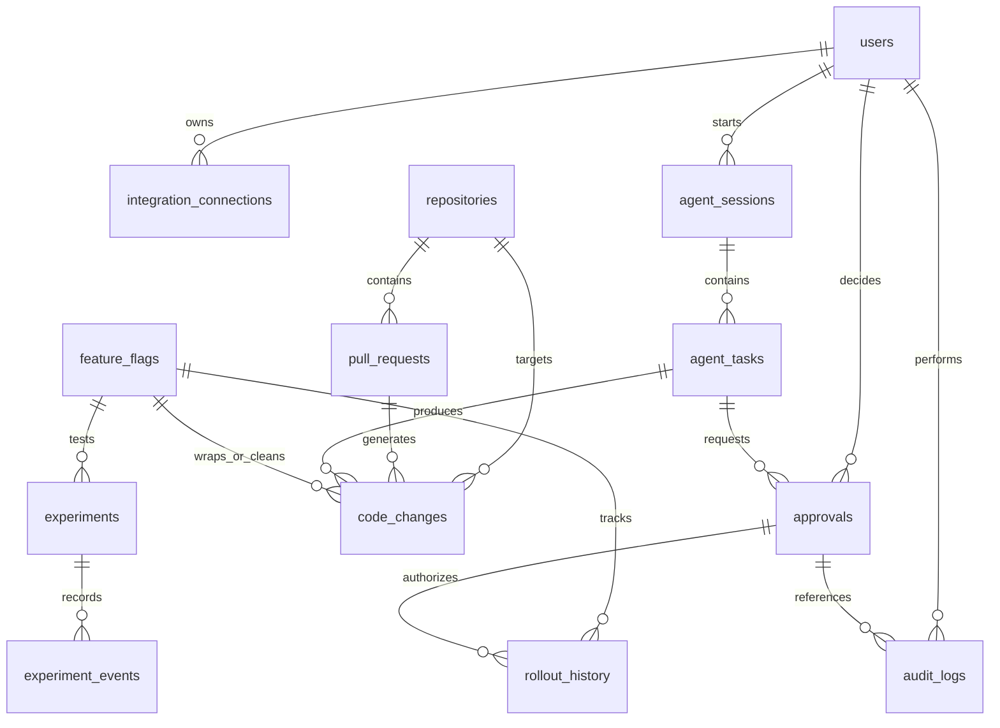
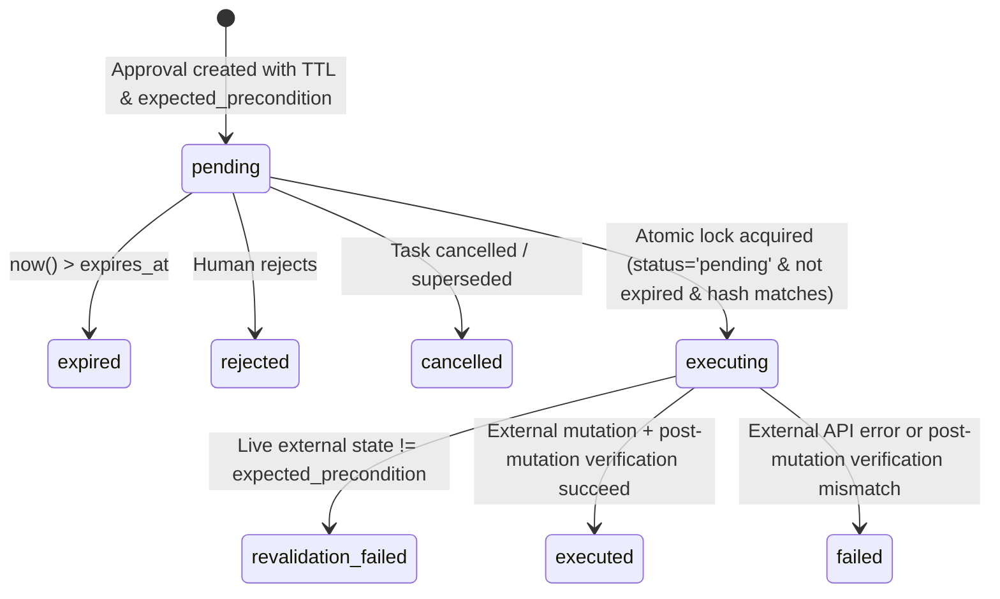

# ReleaseGuard AI — Database Schema & Policy Engine Specification

> **Document Scope:** Phase 1 authoritative PostgreSQL/SQLite database schema (15 tables), encryption architecture, and Category A/B/C Policy Engine & Human Approval invariants.
> **Related Specs:** [System Architecture](file:///c:/Projects/ReleaseGuard%20AI/docs/architecture.md) | [API & Tool Contracts](file:///c:/Projects/ReleaseGuard%20AI/docs/api.md)

---

## 1. Database Engine & Portability Strategy

- **Primary Engine**: PostgreSQL 16 (`postgresql+asyncpg://...`) in Docker and production deployments.
- **Local Fallback Engine**: SQLite 3 (`sqlite+aiosqlite:///...`) when `USE_SQLITE_FALLBACK=true` (local non-Docker dev and `pytest`).
- **SQLAlchemy 2.0 Portability Rules** (MUST be enforced in `backend/app/core/database.py` and `backend/app/models/`):
  1. **UUID Primary & Foreign Keys**: Use `sqlalchemy.Uuid(as_uuid=True)` (`Mapped[uuid.UUID]`). Renders natively as `UUID` on PostgreSQL and `CHAR(32)`/`CHAR(36)` on SQLite. Default factory: `uuid.uuid4`.
  2. **JSONB Compatibility**: Define `JSONBCompat = JSONB().with_variant(JSON(), "sqlite")` for structured JSON columns.
  3. **Portable Enums**: Define Python `StrEnum` classes paired with `SAEnum(MyEnum, native_enum=False, length=50)` (and `CHECK` constraints where helpful) so Alembic migrations avoid PostgreSQL `CREATE TYPE` / `ALTER TYPE` lock hazards and execute identically on SQLite.
  4. **Timestamps**: Use `DateTime(timezone=True)` storing UTC timestamps (`func.now()` server default + Python `datetime.now(UTC)` onupdate).
  5. **Alembic Batch Mode**: Configure `render_as_batch=(context.get_bind().dialect.name == "sqlite")` in `backend/alembic/env.py`.

---

## 2. Entity-Relationship Overview



---

## 3. Complete Table Specifications

### 3.1 `users`
Stores control-plane operators and workspace identities.

| Column | Type | Constraints | Description |
| :--- | :--- | :--- | :--- |
| `id` | `UUID` | `PK`, default `uuid4` | User ID |
| `email` | `VARCHAR(255)` | `NOT NULL`, `UNIQUE` | Normalized lowercase email |
| `display_name` | `VARCHAR(120)` | `NOT NULL` | Display name shown in approvals & audit logs |
| `role` | `VARCHAR(50)` | `NOT NULL`, default `'admin'` | Enum: `admin`, `release_manager`, `engineer`, `viewer` |
| `is_active` | `BOOLEAN` | `NOT NULL`, default `true` | Active flag |
| `created_at` | `TIMESTAMPTZ` | `NOT NULL`, default `now()` | Creation timestamp |
| `updated_at` | `TIMESTAMPTZ` | `NOT NULL`, default `now()` | Last updated timestamp |

**Indexes:** `ix_users_email` (unique on `email`).

---

### 3.2 `integration_connections`
Stores external service credentials encrypted at rest using Fernet. Secrets are **never** exposed in API responses.

| Column | Type | Constraints | Description |
| :--- | :--- | :--- | :--- |
| `id` | `UUID` | `PK`, default `uuid4` | Connection ID |
| `user_id` | `UUID` | `FK -> users.id ON DELETE SET NULL`, nullable | Owner user (nullable for system/env-bootstrapped connection) |
| `provider` | `VARCHAR(50)` | `NOT NULL` | Enum: `github`, `flagsmith` |
| `auth_mode` | `VARCHAR(50)` | `NOT NULL` | Enum: `oauth`, `pat`, `org_token` |
| `status` | `VARCHAR(50)` | `NOT NULL`, default `'connected'` | Enum: `connected`, `disconnected`, `error`, `expired` |
| `external_account_id` | `VARCHAR(120)` | nullable | GitHub login/user ID or Flagsmith org ID |
| `external_account_name` | `VARCHAR(255)` | nullable | GitHub username or Flagsmith org name |
| `scopes` | `JSONBCompat` | `NOT NULL`, default `[]` | Granted OAuth/PAT scopes list |
| `access_token_encrypted` | `TEXT` | `NOT NULL` | Fernet-encrypted token (`gAAAAA...`) |
| `refresh_token_encrypted` | `TEXT` | nullable | Fernet-encrypted refresh token if OAuth refresh enabled |
| `token_hint` | `VARCHAR(32)` | `NOT NULL` | Masked suffix e.g. `••••7a2f` for UI display |
| `key_version` | `INTEGER` | `NOT NULL`, default `1` | Encryption key version for rotation |
| `metadata_json` | `JSONBCompat` | `NOT NULL`, default `{}` | Non-secret metadata (e.g., Flagsmith project_id, env keys map) |
| `last_verified_at` | `TIMESTAMPTZ` | nullable | Last successful external API health probe |
| `expires_at` | `TIMESTAMPTZ` | nullable | Token expiry if applicable |
| `created_at` | `TIMESTAMPTZ` | `NOT NULL`, default `now()` | Creation timestamp |
| `updated_at` | `TIMESTAMPTZ` | `NOT NULL`, default `now()` | Last update timestamp |

**Indexes:** `uq_integration_provider_account` (`provider`, `external_account_id`), `ix_integration_provider_status` (`provider`, `status`).

---

### 3.3 `repositories`
Connected GitHub repositories monitored by PR Intelligence and Flag Health code scanning.

| Column | Type | Constraints | Description |
| :--- | :--- | :--- | :--- |
| `id` | `UUID` | `PK`, default `uuid4` | Repository ID |
| `connection_id` | `UUID` | `FK -> integration_connections.id ON DELETE SET NULL`, nullable | GitHub connection reference |
| `github_repo_id` | `BIGINT` | `NOT NULL`, `UNIQUE` | Numeric GitHub repo ID |
| `owner` | `VARCHAR(120)` | `NOT NULL` | GitHub org or username |
| `name` | `VARCHAR(120)` | `NOT NULL` | Repo name |
| `full_name` | `VARCHAR(255)` | `NOT NULL`, `UNIQUE` | `owner/name` |
| `default_branch` | `VARCHAR(120)` | `NOT NULL`, default `'main'` | Default base branch |
| `is_private` | `BOOLEAN` | `NOT NULL`, default `false` | Private repo indicator |
| `flagsmith_project_id` | `INTEGER` | nullable | Linked Flagsmith project ID |
| `language` | `VARCHAR(64)` | nullable | Primary repository language |
| `last_synced_at` | `TIMESTAMPTZ` | nullable | Last branch/PR/code sync timestamp |
| `created_at` | `TIMESTAMPTZ` | `NOT NULL`, default `now()` | Creation timestamp |
| `updated_at` | `TIMESTAMPTZ` | `NOT NULL`, default `now()` | Last update timestamp |

**Indexes:** `ix_repositories_full_name` (`full_name`), `ix_repositories_owner_name` (`owner`, `name`).

---

### 3.4 `pull_requests`
GitHub pull requests synced into ReleaseGuard AI along with Risk Assessments and Flag Opportunity findings.

| Column | Type | Constraints | Description |
| :--- | :--- | :--- | :--- |
| `id` | `UUID` | `PK`, default `uuid4` | PR record ID |
| `repository_id` | `UUID` | `FK -> repositories.id ON DELETE CASCADE`, `NOT NULL` | Parent repository |
| `github_pr_number` | `INTEGER` | `NOT NULL` | PR number in GitHub |
| `title` | `VARCHAR(500)` | `NOT NULL` | PR title (sanitized for display; wrapped when sent to LLM) |
| `body` | `TEXT` | nullable | PR description |
| `author_login` | `VARCHAR(120)` | `NOT NULL` | GitHub author login |
| `head_branch` | `VARCHAR(255)` | `NOT NULL` | Source branch |
| `base_branch` | `VARCHAR(255)` | `NOT NULL` | Target branch |
| `head_sha` | `VARCHAR(64)` | `NOT NULL` | Latest commit SHA on head branch |
| `state` | `VARCHAR(50)` | `NOT NULL`, default `'open'` | Enum: `open`, `closed`, `merged` |
| `is_draft` | `BOOLEAN` | `NOT NULL`, default `false` | Draft PR flag |
| `html_url` | `VARCHAR(500)` | `NOT NULL` | GitHub PR URL |
| `analysis_status` | `VARCHAR(50)` | `NOT NULL`, default `'pending'` | Enum: `pending`, `analyzing`, `completed`, `failed` |
| `risk_score` | `INTEGER` | nullable | `0` to `100` (`CHECK (risk_score >= 0 AND risk_score <= 100)`) |
| `risk_level` | `VARCHAR(50)` | nullable | Enum: `low`, `medium`, `high`, `critical` |
| `analysis_summary` | `TEXT` | nullable | AI-generated PR architectural summary |
| `confirmed_risks` | `JSONBCompat` | `NOT NULL`, default `[]` | Array of `{title, severity, file_path, line_range, evidence, mitigation}` |
| `potential_risks` | `JSONBCompat` | `NOT NULL`, default `[]` | Array of `{title, severity, assumption, verification_needed}` |
| `flag_opportunities` | `JSONBCompat` | `NOT NULL`, default `[]` | Array of `{suggested_flag_key, flag_type, target_files, rationale, recommended_rollout}` |
| `analyzed_at` | `TIMESTAMPTZ` | nullable | Last completed AI analysis timestamp |
| `created_at` | `TIMESTAMPTZ` | `NOT NULL`, default `now()` | Record creation timestamp |
| `updated_at` | `TIMESTAMPTZ` | `NOT NULL`, default `now()` | Record update timestamp |

**Indexes:** `uq_pr_repo_number` (`repository_id`, `github_pr_number`), `ix_pr_risk_level` (`risk_level`), `ix_pr_analysis_status` (`analysis_status`).

---

### 3.5 `agent_sessions`
Conversation and LangGraph thread context for the Agent Workspace (`/agent`) and automated module runs.

| Column | Type | Constraints | Description |
| :--- | :--- | :--- | :--- |
| `id` | `UUID` | `PK`, default `uuid4` | Session ID |
| `user_id` | `UUID` | `FK -> users.id ON DELETE SET NULL`, nullable | Initiating operator |
| `title` | `VARCHAR(255)` | `NOT NULL`, default `'New Agent Session'` | Session title |
| `thread_id` | `VARCHAR(128)` | `NOT NULL`, `UNIQUE` | LangGraph `configurable.thread_id` |
| `active_specialist` | `VARCHAR(50)` | `NOT NULL`, default `'supervisor'` | Enum: `supervisor`, `pr_agent`, `flag_agent`, `experiment_agent` |
| `status` | `VARCHAR(50)` | `NOT NULL`, default `'active'` | Enum: `active`, `paused_approval`, `completed`, `archived` |
| `context_scope` | `JSONBCompat` | `NOT NULL`, default `{}` | Bound `{repository_id, pull_request_id, flagsmith_project_id, environment}` |
| `message_history` | `JSONBCompat` | `NOT NULL`, default `[]` | Sanitized chat turn history rendered by `/agent` |
| `created_at` | `TIMESTAMPTZ` | `NOT NULL`, default `now()` | Creation timestamp |
| `updated_at` | `TIMESTAMPTZ` | `NOT NULL`, default `now()` | Last update timestamp |

**Indexes:** `ix_agent_sessions_thread_id` (unique), `ix_agent_sessions_user_updated` (`user_id`, `updated_at`).

---

### 3.6 `agent_tasks`
Individual execution runs within an `agent_session`, backing SSE live streaming and polling replay.

| Column | Type | Constraints | Description |
| :--- | :--- | :--- | :--- |
| `id` | `UUID` | `PK`, default `uuid4` | Task ID |
| `session_id` | `UUID` | `FK -> agent_sessions.id ON DELETE CASCADE`, `NOT NULL` | Parent session |
| `specialist` | `VARCHAR(50)` | `NOT NULL` | Enum: `supervisor`, `pr_agent`, `flag_agent`, `experiment_agent` |
| `user_prompt` | `TEXT` | `NOT NULL` | Input prompt that triggered this task |
| `status` | `VARCHAR(50)` | `NOT NULL`, default `'queued'` | Enum: `queued`, `running`, `awaiting_approval`, `completed`, `failed`, `cancelled` |
| `steps_log` | `JSONBCompat` | `NOT NULL`, default `[]` | Ordered array of `{seq, event_type, timestamp, payload}` for SSE replay & polling |
| `final_response` | `TEXT` | nullable | Final assistant response markdown |
| `error_message` | `TEXT` | nullable | Failure diagnostics if `failed` |
| `gemini_model` | `VARCHAR(100)` | nullable | Model ID used for execution |
| `token_usage` | `JSONBCompat` | `NOT NULL`, default `{}` | `{prompt_tokens, candidate_tokens, total_tokens}` |
| `started_at` | `TIMESTAMPTZ` | nullable | Execution start time |
| `completed_at` | `TIMESTAMPTZ` | nullable | Execution completion time |
| `created_at` | `TIMESTAMPTZ` | `NOT NULL`, default `now()` | Creation timestamp |
| `updated_at` | `TIMESTAMPTZ` | `NOT NULL`, default `now()` | Update timestamp |

**Indexes:** `ix_agent_tasks_session_created` (`session_id`, `created_at`), `ix_agent_tasks_status` (`status`).

---

### 3.7 `code_changes`
Generated Flagsmith-wrapping patches, cleanup patches, unit tests, isolated validation reports, and resulting Draft PR metadata.

| Column | Type | Constraints | Description |
| :--- | :--- | :--- | :--- |
| `id` | `UUID` | `PK`, default `uuid4` | Code change ID |
| `repository_id` | `UUID` | `FK -> repositories.id ON DELETE CASCADE`, `NOT NULL` | Target repo |
| `pull_request_id` | `UUID` | `FK -> pull_requests.id ON DELETE SET NULL`, nullable | Source PR (if triggered from PR analysis) |
| `feature_flag_id` | `UUID` | `FK -> feature_flags.id ON DELETE SET NULL`, nullable | Related flag (wrapping or cleanup) |
| `agent_task_id` | `UUID` | `FK -> agent_tasks.id ON DELETE SET NULL`, nullable | Generating task |
| `change_type` | `VARCHAR(50)` | `NOT NULL` | Enum: `flag_wrap`, `flag_cleanup`, `experiment_instrumentation` |
| `flag_key` | `VARCHAR(128)` | `NOT NULL` | Flag key referenced in patch |
| `title` | `VARCHAR(255)` | `NOT NULL` | Patch / Draft PR title |
| `description` | `TEXT` | nullable | Explanation of generated patch |
| `files_diff` | `JSONBCompat` | `NOT NULL`, default `[]` | Array of `{file_path, action: "create"\|"modify", before_code, after_code, unified_diff}` |
| `generated_tests` | `JSONBCompat` | `NOT NULL`, default `[]` | Array of `{file_path, content}` |
| `validation_status` | `VARCHAR(50)` | `NOT NULL`, default `'pending'` | Enum: `pending`, `running`, `passed`, `failed` |
| `validation_report` | `JSONBCompat` | `NOT NULL`, default `{}` | `{ast_ok, path_safety_ok, overwrite_ok, ruff_ok, pytest_ok, eslint_ok, checks: [...], stdout, stderr}` |
| `draft_pr_number` | `INTEGER` | nullable | Created GitHub Draft PR number |
| `draft_pr_url` | `VARCHAR(500)` | nullable | Created GitHub Draft PR URL |
| `draft_branch_name` | `VARCHAR(255)` | nullable | Branch created for Draft PR |
| `status` | `VARCHAR(50)` | `NOT NULL`, default `'draft'` | Enum: `draft`, `validated`, `validation_failed`, `pr_opened`, `discarded` |
| `created_at` | `TIMESTAMPTZ` | `NOT NULL`, default `now()` | Creation timestamp |
| `updated_at` | `TIMESTAMPTZ` | `NOT NULL`, default `now()` | Update timestamp |

**Indexes:** `ix_code_changes_repo_status` (`repository_id`, `status`), `ix_code_changes_pr` (`pull_request_id`), `ix_code_changes_flag` (`feature_flag_id`).

---

### 3.8 `feature_flags`
Synchronized local projection of Flagsmith feature flags, multi-environment states, and Flag Health assessments.

| Column | Type | Constraints | Description |
| :--- | :--- | :--- | :--- |
| `id` | `UUID` | `PK`, default `uuid4` | Internal flag record ID |
| `flagsmith_feature_id` | `INTEGER` | nullable | Flagsmith numeric feature ID |
| `flagsmith_project_id` | `INTEGER` | `NOT NULL` | Flagsmith project ID |
| `repository_id` | `UUID` | `FK -> repositories.id ON DELETE SET NULL`, nullable | Associated repo for code reference scanning |
| `key` | `VARCHAR(128)` | `NOT NULL` | Flagsmith feature name/key (`checkout_v2`) |
| `description` | `TEXT` | nullable | Flag description |
| `flag_type` | `VARCHAR(50)` | `NOT NULL`, default `'STANDARD'` | Enum: `STANDARD`, `MULTIVARIATE` |
| `is_archived` | `BOOLEAN` | `NOT NULL`, default `false` | Archived flag state |
| `env_states` | `JSONBCompat` | `NOT NULL`, default `{}` | Map keyed by env (`development`, `staging`, `production`): `{env_key, is_production, use_v2_versioning, enabled, value, rollout_percentage, mv_options, segment_overrides, version_uuid}` |
| `mv_options` | `JSONBCompat` | `NOT NULL`, default `[]` | Project-level multivariate option definitions |
| `code_references` | `JSONBCompat` | `NOT NULL`, default `[]` | Array of `{file_path, line_number, snippet}` found in repo |
| `health_score` | `INTEGER` | `NOT NULL`, default `100` | Explainable `0-100` score (`CHECK (health_score >= 0 AND health_score <= 100)`) |
| `health_issues` | `JSONBCompat` | `NOT NULL`, default `[]` | Array of `{issue_type, penalty, summary, evidence}` (`stale`, `unused`, `always_on`, `always_off`, `orphaned`, `duplicate`, `env_drift`) |
| `last_synced_at` | `TIMESTAMPTZ` | nullable | Last Flagsmith API sync timestamp |
| `last_health_scan_at` | `TIMESTAMPTZ` | nullable | Last Flag Health Monitor scan timestamp |
| `flagsmith_created_at` | `TIMESTAMPTZ` | nullable | Creation date reported by Flagsmith |
| `created_at` | `TIMESTAMPTZ` | `NOT NULL`, default `now()` | Creation timestamp |
| `updated_at` | `TIMESTAMPTZ` | `NOT NULL`, default `now()` | Last update timestamp |

**Indexes:** `uq_flag_project_key` (`flagsmith_project_id`, `key`), `ix_flag_health_score` (`health_score`).

---

### 3.9 `experiments`
Experiment definitions, traffic plans, analytics capability mode, latest Bayesian evaluation summary, and release recommendation.

| Column | Type | Constraints | Description |
| :--- | :--- | :--- | :--- |
| `id` | `UUID` | `PK`, default `uuid4` | Experiment ID |
| `feature_flag_id` | `UUID` | `FK -> feature_flags.id ON DELETE CASCADE`, `NOT NULL` | Underlying feature flag |
| `name` | `VARCHAR(255)` | `NOT NULL` | Human-readable experiment name |
| `hypothesis` | `TEXT` | `NOT NULL` | Null/alternative hypothesis statement |
| `environment_name` | `VARCHAR(64)` | `NOT NULL` | Target environment (`staging`, `production`, etc.) |
| `environment_key` | `VARCHAR(128)` | nullable | Flagsmith environment API key |
| `analytics_mode` | `VARCHAR(50)` | `NOT NULL`, default `'tracked_event_fallback'` | Enum: `flagsmith_native`, `tracked_event_fallback` |
| `flagsmith_experiment_id` | `VARCHAR(128)` | nullable | Native Flagsmith experiment ID if `flagsmith_native` |
| `status` | `VARCHAR(50)` | `NOT NULL`, default `'draft'` | Enum: `draft`, `running`, `paused`, `completed`, `rolled_back` |
| `control_variation` | `VARCHAR(64)` | `NOT NULL`, default `'control'` | Control variant name (`v1`) |
| `treatment_variation` | `VARCHAR(64)` | `NOT NULL`, default `'treatment'` | Treatment variant name (`v2`) |
| `traffic_allocation` | `JSONBCompat` | `NOT NULL`, default `{"control": 50, "treatment": 50}` | Percentage allocation per variant |
| `primary_metric` | `VARCHAR(64)` | `NOT NULL`, default `'checkout_completed'` | Primary conversion event type |
| `guardrail_metrics` | `JSONBCompat` | `NOT NULL`, default `["payment_failed", "checkout_abandoned"]` | Guardrail event types |
| `guardrail_thresholds` | `JSONBCompat` | `NOT NULL`, default `{}` | `{min_exposures, max_expected_loss, guardrail_max_error_rate, soft_error_delta, hard_error_delta}` |
| `latest_bayesian_result` | `JSONBCompat` | nullable | Cached Bayesian posterior computation JSON |
| `latest_recommendation` | `VARCHAR(50)` | nullable | Enum: `Continue Monitoring`, `Expand Rollout`, `Maintain Current Rollout`, `Reduce Rollout`, `Recommend Rollback` |
| `recommendation_rationale` | `TEXT` | nullable | Deterministic + Gemini plain-English explanation |
| `started_at` | `TIMESTAMPTZ` | nullable | Experiment start timestamp |
| `ended_at` | `TIMESTAMPTZ` | nullable | Experiment end timestamp |
| `created_at` | `TIMESTAMPTZ` | `NOT NULL`, default `now()` | Creation timestamp |
| `updated_at` | `TIMESTAMPTZ` | `NOT NULL`, default `now()` | Last update timestamp |

**Indexes:** `ix_experiments_flag_status` (`feature_flag_id`, `status`), `ix_experiments_env` (`environment_name`).

---

### 3.10 `experiment_events`
Tracked-Events Fallback Analytics Layer (`tracked_event_fallback`) storing real telemetry emitted by `demo-app` or external services.

| Column | Type | Constraints | Description |
| :--- | :--- | :--- | :--- |
| `id` | `UUID` | `PK`, default `uuid4` | Internal event row ID |
| `event_id` | `VARCHAR(128)` | `NOT NULL`, `UNIQUE` | Client/emitter idempotency UUID preventing duplicate counting |
| `experiment_id` | `UUID` | `FK -> experiments.id ON DELETE SET NULL`, nullable | Resolved experiment (matched via `flag_key` + `environment_name` or explicit ID) |
| `flag_key` | `VARCHAR(128)` | `NOT NULL` | Feature flag key (`checkout_v2`) |
| `environment_name` | `VARCHAR(64)` | `NOT NULL` | Environment (`development`, `staging`, `production`) |
| `variation_key` | `VARCHAR(64)` | `NOT NULL` | Evaluated variation (`control`, `treatment`, `v1`, `v2`, `true`, `false`) |
| `event_type` | `VARCHAR(50)` | `NOT NULL` | Enum: `feature_variation_assigned`, `checkout_started`, `checkout_completed`, `checkout_abandoned`, `payment_failed` |
| `user_identifier` | `VARCHAR(128)` | `NOT NULL` | Pseudonymous user/session identifier |
| `session_key` | `VARCHAR(128)` | nullable | Checkout attempt/order session key |
| `numeric_value` | `DOUBLE PRECISION` | nullable | Optional order amount / latency ms |
| `properties` | `JSONBCompat` | `NOT NULL`, default `{}` | Additional structured event properties (error code, promo used, step) |
| `occurred_at` | `TIMESTAMPTZ` | `NOT NULL` | Event timestamp from emitter |
| `created_at` | `TIMESTAMPTZ` | `NOT NULL`, default `now()` | Ingestion timestamp |

**Indexes:** `ix_exp_events_exp_var_type` (`experiment_id`, `variation_key`, `event_type`), `ix_exp_events_flag_env_time` (`flag_key`, `environment_name`, `occurred_at`), `ix_exp_events_user` (`user_identifier`).

---

### 3.11 `approvals`
Single-use, SHA-256 hash-bound approval requests governing Category B (when confirmation enabled) and ALL Category C actions.

| Column | Type | Constraints | Description |
| :--- | :--- | :--- | :--- |
| `id` | `UUID` | `PK`, default `uuid4` | Approval ID |
| `agent_task_id` | `UUID` | `FK -> agent_tasks.id ON DELETE SET NULL`, nullable | Requesting agent task |
| `requested_by_id` | `UUID` | `FK -> users.id ON DELETE SET NULL`, nullable | Requesting user |
| `decided_by_id` | `UUID` | `FK -> users.id ON DELETE SET NULL`, nullable | Approving/rejecting user |
| `policy_category` | `VARCHAR(10)` | `NOT NULL` | Enum: `B`, `C` |
| `action_type` | `VARCHAR(100)` | `NOT NULL` | Canonical action identifier (e.g., `flagsmith.set_gradual_rollout_stage`) |
| `target_resource_type` | `VARCHAR(64)` | `NOT NULL` | E.g. `feature_flag`, `pull_request`, `experiment`, `code_change` |
| `target_resource_id` | `VARCHAR(128)` | `NOT NULL` | UUID or key of target resource |
| `environment_name` | `VARCHAR(64)` | nullable | Target environment (`production`, `staging`, etc.) |
| `title` | `VARCHAR(255)` | `NOT NULL` | Human-readable summary of proposed change |
| `rationale` | `TEXT` | nullable | AI/system justification & risk summary |
| `action_payload` | `JSONBCompat` | `NOT NULL` | Exact normalized arguments to execute upon approval |
| `expected_precondition` | `JSONBCompat` | `NOT NULL`, default `{}` | Live state snapshot required at revalidation time |
| `action_hash` | `CHAR(64)` | `NOT NULL` | Lowercase hex SHA-256 of canonical `(action_type, target_resource_type, target_resource_id, environment_name, action_payload)` |
| `idempotency_key` | `VARCHAR(128)` | `NOT NULL`, `UNIQUE` | Deduplicates identical pending/executed executions |
| `status` | `VARCHAR(50)` | `NOT NULL`, default `'pending'` | Enum: `pending`, `executing`, `executed`, `rejected`, `expired`, `revalidation_failed`, `failed`, `cancelled` |
| `decision_comment` | `TEXT` | nullable | Human reviewer note on approve/reject |
| `execution_result` | `JSONBCompat` | nullable | Post-mutation verified external API response |
| `expires_at` | `TIMESTAMPTZ` | `NOT NULL` | Strict TTL expiration (`created_at + APPROVAL_TTL_SECONDS`) |
| `decided_at` | `TIMESTAMPTZ` | nullable | Timestamp of human decision |
| `executed_at` | `TIMESTAMPTZ` | nullable | Timestamp of completed execution |
| `created_at` | `TIMESTAMPTZ` | `NOT NULL`, default `now()` | Creation timestamp |
| `updated_at` | `TIMESTAMPTZ` | `NOT NULL`, default `now()` | Update timestamp |

**Indexes:** `ix_approvals_status_expires` (`status`, `expires_at`), `ix_approvals_action_hash` (`action_hash`), `ix_approvals_task` (`agent_task_id`).

---

### 3.12 `rollout_history`
Immutable timeline of every flag toggle, percentage rollout progression, multivariate change, and rollback across environments.

| Column | Type | Constraints | Description |
| :--- | :--- | :--- | :--- |
| `id` | `UUID` | `PK`, default `uuid4` | Rollout history entry ID |
| `feature_flag_id` | `UUID` | `FK -> feature_flags.id ON DELETE CASCADE`, `NOT NULL` | Flag mutated |
| `approval_id` | `UUID` | `FK -> approvals.id ON DELETE SET NULL`, nullable | Authorizing approval (required for Category C) |
| `actor_id` | `UUID` | `FK -> users.id ON DELETE SET NULL`, nullable | Executing/approving operator |
| `environment_name` | `VARCHAR(64)` | `NOT NULL` | Environment mutated |
| `action` | `VARCHAR(50)` | `NOT NULL` | Enum: `enable`, `disable`, `rollout_step`, `multivariate_update`, `segment_override`, `rollback`, `version_publish` |
| `previous_state` | `JSONBCompat` | `NOT NULL` | Pre-mutation snapshot (`enabled`, `percentage`, `mv_weights`, `version_uuid`) |
| `new_state` | `JSONBCompat` | `NOT NULL` | Target & verified post-mutation snapshot |
| `verified` | `BOOLEAN` | `NOT NULL`, default `false` | `true` only after post-mutation readback matches `new_state` |
| `verification_details` | `JSONBCompat` | `NOT NULL`, default `{}` | Readback comparison & Flagsmith version UUID |
| `reason` | `TEXT` | nullable | Human/recommendation justification |
| `created_at` | `TIMESTAMPTZ` | `NOT NULL`, default `now()` | Immutable event timestamp |

**Indexes:** `ix_rollout_flag_env_time` (`feature_flag_id`, `environment_name`, `created_at`), `ix_rollout_created` (`created_at`).

---

### 3.13 `audit_logs`
Append-only compliance log recording every policy decision, tool invocation, approval event, mutation, and verification failure.

| Column | Type | Constraints | Description |
| :--- | :--- | :--- | :--- |
| `id` | `UUID` | `PK`, default `uuid4` | Audit log ID |
| `actor_type` | `VARCHAR(50)` | `NOT NULL` | Enum: `user`, `agent`, `system`, `demo_emitter` |
| `actor_id` | `VARCHAR(128)` | nullable | User UUID, specialist name, or system component |
| `policy_category` | `VARCHAR(10)` | `NOT NULL` | Enum: `A`, `B`, `C`, `DENY` |
| `event_action` | `VARCHAR(120)` | `NOT NULL` | Dotted event name (e.g., `approval.approved`, `flagsmith.rollout_executed`, `policy.blocked_merge`) |
| `resource_type` | `VARCHAR(64)` | `NOT NULL` | Resource type (`feature_flag`, `pull_request`, `approval`, etc.) |
| `resource_id` | `VARCHAR(128)` | nullable | Target resource UUID or key |
| `environment_name` | `VARCHAR(64)` | nullable | Environment if applicable |
| `approval_id` | `UUID` | `FK -> approvals.id ON DELETE SET NULL`, nullable | Associated approval |
| `action_hash` | `CHAR(64)` | nullable | SHA-256 hash if policy-gated action |
| `status` | `VARCHAR(50)` | `NOT NULL` | Enum: `success`, `blocked`, `failed`, `pending` |
| `details` | `JSONBCompat` | `NOT NULL`, default `{}` | Redacted metadata (never stores raw secrets) |
| `created_at` | `TIMESTAMPTZ` | `NOT NULL`, default `now()` | Immutable creation timestamp |

**Indexes:** `ix_audit_created` (`created_at`), `ix_audit_category_action` (`policy_category`, `event_action`), `ix_audit_resource` (`resource_type`, `resource_id`).

---

### 3.14 `langgraph_checkpoints`
Portable persistence table backing `SqlAlchemyCheckpointSaver` across PostgreSQL and SQLite.

| Column | Type | Constraints | Description |
| :--- | :--- | :--- | :--- |
| `thread_id` | `VARCHAR(128)` | `PK (composite)` | LangGraph thread identifier |
| `checkpoint_ns` | `VARCHAR(128)` | `PK (composite)`, default `''` | Checkpoint namespace |
| `checkpoint_id` | `VARCHAR(128)` | `PK (composite)` | Monotonic checkpoint UUID/ULID |
| `parent_checkpoint_id` | `VARCHAR(128)` | nullable | Parent checkpoint reference |
| `checkpoint_json` | `TEXT` | `NOT NULL` | JSON-serialized LangGraph checkpoint payload |
| `metadata_json` | `TEXT` | `NOT NULL`, default `'{}'` | JSON-serialized checkpoint metadata |
| `pending_writes_json` | `TEXT` | `NOT NULL`, default `'[]'` | JSON-serialized pending channel writes / interrupts |
| `created_at` | `TIMESTAMPTZ` | `NOT NULL`, default `now()` | Checkpoint write time |

**Indexes:** `ix_lg_ckpt_thread_created` (`thread_id`, `checkpoint_ns`, `created_at`).

---

### 3.15 `workspace_settings`
Single-row (or per-workspace) persisted configuration editable from `/settings`.

| Column | Type | Constraints | Description |
| :--- | :--- | :--- | :--- |
| `id` | `UUID` | `PK`, default `uuid4` | Settings ID |
| `singleton_key` | `VARCHAR(32)` | `NOT NULL`, `UNIQUE`, default `'default'` | Enforces singleton row |
| `category_b_requires_confirmation` | `BOOLEAN` | `NOT NULL`, default `true` | Policy toggle for Category B actions |
| `approval_ttl_seconds` | `INTEGER` | `NOT NULL`, default `900` | Expiration TTL for new approvals (`60..86400`) |
| `gemini_model` | `VARCHAR(100)` | `NOT NULL`, default `'gemini-2.5-flash'` | Active Gemini model name |
| `flagsmith_analytics_mode` | `VARCHAR(50)` | `NOT NULL`, default `'tracked_event_fallback'` | Enum: `flagsmith_native`, `tracked_event_fallback` |
| `flagsmith_capability_probed_at` | `TIMESTAMPTZ` | nullable | Last Flagsmith experiment capability probe time |
| `default_guardrails` | `JSONBCompat` | `NOT NULL`, default `{}` | `{min_exposures: 100, max_expected_loss: 0.005, guardrail_max_error_rate: 0.05, soft_error_delta: 0.015, hard_error_delta: 0.030}` |
| `health_thresholds` | `JSONBCompat` | `NOT NULL`, default `{}` | `{stale_days: 30, unused_days: 14, always_on_days: 30, always_off_days: 30}` |
| `updated_at` | `TIMESTAMPTZ` | `NOT NULL`, default `now()` | Last updated timestamp |

---

## 4. Secrets & Encryption Policy

1. **Symmetric Encryption**: All GitHub OAuth tokens, PATs, and Flagsmith org tokens MUST be encrypted using `cryptography.fernet.Fernet(settings.ENCRYPTION_KEY)` prior to DB persistence in `integration_connections`.
2. **Startup Guard**: If `ENCRYPTION_KEY` is missing in `production`, backend startup MUST fail fast. In `development`/`test`, `.env.example` provides a documented command to generate a valid 32-byte URL-safe base64 Fernet key (`python -c "from cryptography.fernet import Fernet; print(Fernet.generate_key().decode())"`).
3. **Zero-Leakage Logging & API Responses**:
   - API schemas return `token_hint` (last 4 characters) and `status` only—never raw or encrypted tokens.
   - Logging filter scrubs `Authorization`, `X-Environment-Key`, `GEMINI_API_KEY`, and `gAAAAA...` prefixes.
   - Isolated temp-dir patch validation strips all secret environment variables from subprocess `env`.

---

## 5. Policy Engine & Approval Execution Protocol

### 5.1 Production Environment Classification
An environment is classified as **production** (`is_production = True`) if ANY of the following holds:
1. Flagsmith environment metadata or `feature_flags.env_states[env]` marks `is_production == True`, OR
2. Normalized `environment_name.lower()` matches `{"prod", "production", "live", "prd"}` or contains `"prod"`.
When environment classification is unknown or ambiguous, the Policy Engine **fails closed** and treats it as `is_production = True` (Category C).

### 5.2 Action Category Matrix

| Category | Gate Rule | Covered Operations |
| :--- | :--- | :--- |
| **A — Read / Analyze / Plan** | Auto-execute immediately; log tool execution in `audit_logs` | GitHub repo/branch/PR/diff/file reads; PR risk assessment; flag opportunity detection; patch generation in DB; isolated temp-dir validation; Flagsmith reads & live-state verification; capability probe; Bayesian stats; release recommendations; flag health scan; incident investigation |
| **B — Reversible / Non-Prod / Draft PR** | Auto-execute if `category_b_requires_confirmation == false`; create single-use `Approval` + pause if `true` | Creating Flagsmith feature definition (default disabled in prod); toggling/rolling out/configuring segments or multivariate splits in **non-production** (`development`, `staging`); opening GitHub branches & **Draft PRs** (`draft: true`); creating/activating experiments in non-prod |
| **C — Production or Destructive** | **Mandatory explicit single-use human approval.** Never auto-executed; cannot be disabled via settings | Any Flagsmith mutation in **production** (toggle ON/OFF, rollout `%` advance/reduce, segment override, multivariate allocation, v2 version publish, emergency rollback); activating/stopping a prod experiment; deleting/archiving ANY Flagsmith flag in any environment |
| **FORBIDDEN** | **Hard-blocked at Policy Gate & Tool Registry.** Returns policy violation + `audit_logs(policy_category='DENY')` | Auto-merging any GitHub PR; force-pushing branches; pushing directly to `main`/`master`; modifying `.git/` or host filesystem outside temp validator; bypassing `action_hash` |

### 5.3 Canonical `action_hash` Calculation

Every Category B/C action computes a deterministic `SHA-256` digest over canonical sorted JSON:

```python
import hashlib, json

def compute_action_hash(
    action_type: str,
    target_resource_type: str,
    target_resource_id: str,
    environment_name: str | None,
    action_payload: dict,
) -> str:
    canonical_obj = {
        "action_type": action_type,
        "target_resource_type": target_resource_type,
        "target_resource_id": str(target_resource_id),
        "environment_name": environment_name or "",
        "action_payload": action_payload,
    }
    serialized = json.dumps(canonical_obj, sort_keys=True, separators=(",", ":"), ensure_ascii=True)
    return hashlib.sha256(serialized.encode("utf-8")).hexdigest()
```

If an approval payload is tampered with in transit or DB after creation, `compute_action_hash(...) != approval.action_hash` immediately rejects execution and writes a security alert to `audit_logs`.

### 5.4 Single-Use Idempotency Lock, Live Revalidation & Execution State Machine



Exact execution algorithm inside `POST /api/v1/approvals/{approval_id}/approve`:
1. **Hash & TTL Verification**: Recompute `action_hash` from stored fields; verify `approval.action_hash == computed_hash` and `now() <= approval.expires_at`. If expired, atomically transition `pending -> expired` and return HTTP `409 Conflict`.
2. **Atomic Single-Use Lock**: Execute conditional SQL `UPDATE approvals SET status='executing', decided_by_id=:user_id, decided_at=:now, decision_comment=:comment WHERE id=:id AND status='pending' AND expires_at > :now`. If `rowcount != 1`, return HTTP `409 Conflict` (prevents duplicate execution from double-clicks or concurrent calls).
3. **Live-State Precondition Revalidation**: Query live GitHub or Flagsmith state and verify against `approval.expected_precondition` (e.g., flag's live `enabled`, `rollout_percentage`, and `version_uuid` still match what was observed when approval was queued; Draft PR branch doesn't collide; `CodeChange.validation_status == 'passed'`).
   - If drifted -> transition `executing -> revalidation_failed`, log `audit_logs`, resume/fail paused LangGraph task cleanly, return HTTP `409 Conflict` with drift diff.
4. **Execute External Mutation**: Call the bound Flagsmith or GitHub client method exactly once.
5. **Post-Mutation State Verification**: Read back live Flagsmith/GitHub state and verify target invariants match.
   - If verified -> update `approvals.status = 'executed'`, `executed_at = now()`, record `rollout_history` (with `verified=True`) and `audit_logs(status='success')`, and resume LangGraph thread via `Command(resume={"decision": "approved", "approval_id": str(approval.id), "result": result})` if `agent_task_id` is linked.
   - If mismatch or API exception -> update `approvals.status = 'failed'`, record `audit_logs(status='failed')`, and surface clear error to operator.
